# OpenBot Compact

<p align="center">
  <a href="README.md">English</a> |
  <a href="README.zh-CN.md">简体中文</a> |
  <a href="README.de-DE.md">Deutsch</a> |
  <a href="README.fr-FR.md">Français</a> |
  <span>Español</span> |
  <a href="README.ko-KR.md">한국어</a>
</p>

OpenBot Compact es un cuerpo [OpenBot](../../README.es-ES.md) compacto de cuatro ruedas para una tracción con **ESP32 DevKit V1 + L298N**. Tiene una tapa con tetones compatible con LEGO, una cubierta atornillada, un soporte de teléfono inclinable, soportes electrónicos desmontables fijados con tornillos y tres opciones de batería. Todas las piezas impresas caben en una **Bambu Lab A1 mini** (pieza más grande 104 × 168 mm).

<p align="center">
  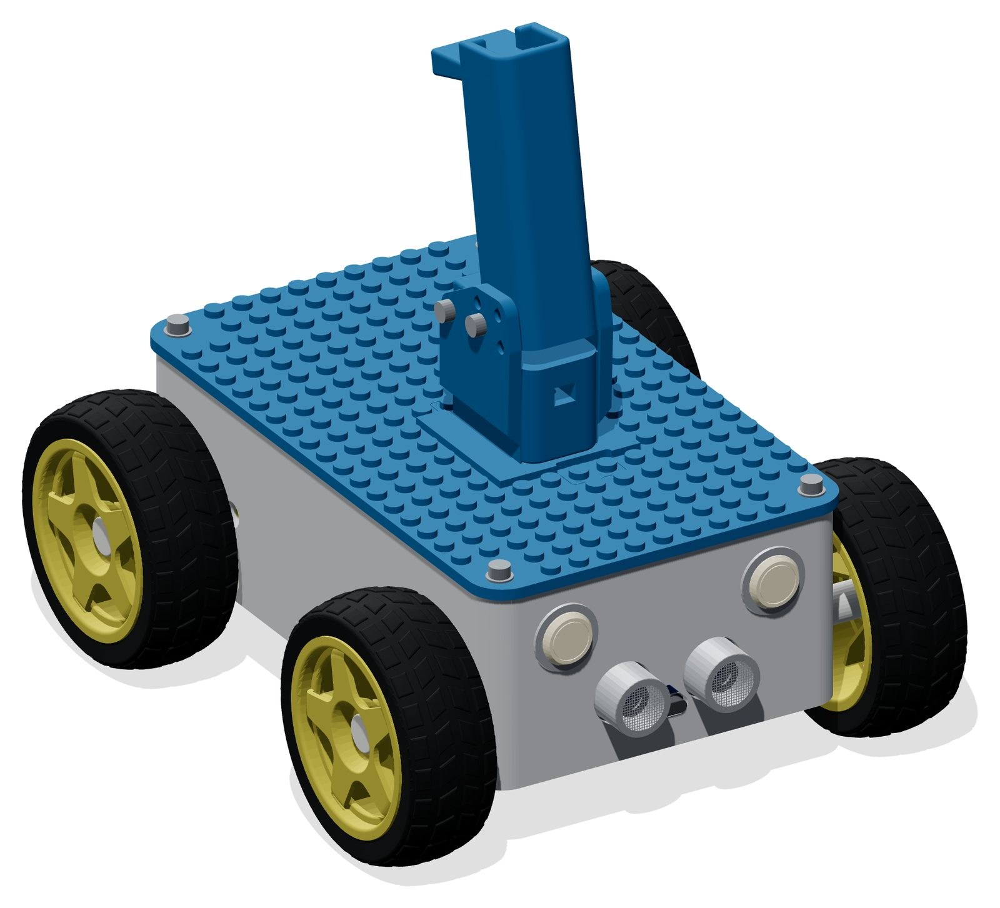
</p>

| | |
|---|---|
| **Tracción** | 4 × motorreductores TT de doble eje; par izquierdo y par derecho en paralelo en un L298N |
| **Controlador** | ESP32 DevKit V1 (30 pines), firmware OpenBot `DIY_ESP32`; conexión con el teléfono por Bluetooth o cable USB |
| **Sensores** | Ultrasonido HC-SR04 (delante), 4 × codificadores ópticos de rueda LM393, tensión de la batería |
| **Alimentación** | Elige una: caja de 18650 2S o 3S sobre la tapa, o una pequeña batería LiPo dentro (ver [Opciones de batería](#opciones-de-batería)) |
| **Tornillería** | Solo tornillos de cabeza alomada M3 × 10 y M3 × 25, tuercas M3 y 19 insertos roscados |
| **Impresión** | PLA, dos placas de A1 mini, ≈ 12 h y ≈ 305 g, más las piezas de la opción de batería elegida |

> **Izquierda y derecha** significan siempre en esta guía la izquierda y la derecha **del propio robot**: colócate detrás del robot (lado del interruptor) y mira hacia delante, por encima de la tapa, hacia el sensor de ultrasonidos. El firmware usa la misma convención para los motores y codificadores «izquierdos» y «derechos».

## Contenido

- [Piezas impresas](#piezas-impresas) · [Impresión](#impresión)
- [Opciones de batería](#opciones-de-batería)
- [Hardware y electrónica que comprar](#hardware-y-electrónica-que-comprar)
- Montaje: [1 Insertos](#1-colocar-los-insertos) · [2 Motores y codificadores](#2-montar-los-motores-y-los-sensores-de-velocidad) · [3 Sensor de ultrasonidos y frontal](#3-fijar-el-sensor-de-ultrasonidos-y-las-piezas-del-frontal) · [4 ESP32 y controlador](#4-montar-el-esp32-y-el-controlador-de-motores) · [5 Cableado](#5-cablear-la-alimentación-y-las-señales) · [6 Firmware y prueba en banco](#6-configurar-el-firmware-y-prueba-en-banco) · [7 Batería, soporte de teléfono y tapa](#7-montar-la-batería-el-soporte-de-teléfono-y-la-tapa)
- [Placa alternativa con controlador integrado](#placa-alternativa-con-controlador-integrado)
- [Solución de problemas](#solución-de-problemas) · [Vistas](#vistas) · [Siguiente paso](#siguiente-paso)

## Piezas impresas

<p align="center">
  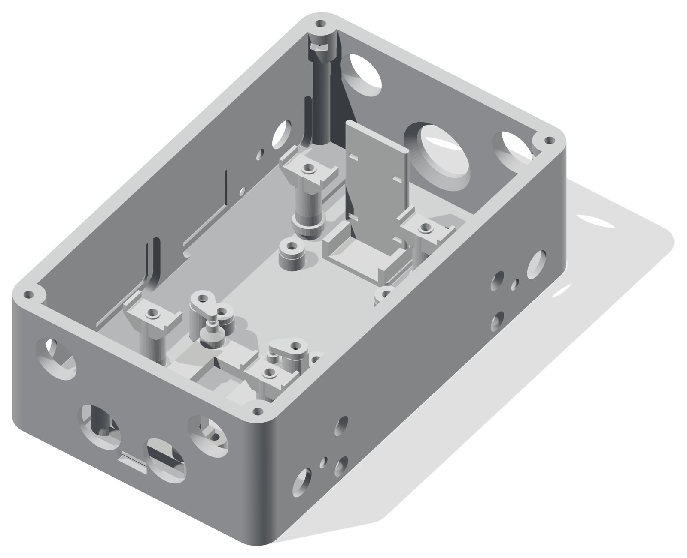
</p>

| Pieza | Cant. | Ubicación / orientación de impresión |
|---|---:|---|
| [bottom_cover](cad/stl/bottom_cover.stl) ([STEP](cad/step/bottom_cover.step)) | 1 | Chasis; fondo hacia abajo, sin soportes |
| [top_cover](cad/stl/top_cover.stl) ([STEP](cad/step/top_cover.step)) | 1 | Tapa con tetones y dos aberturas para cables; cara plana hacia abajo, tetones hacia arriba |
| [lid_plug](cad/stl/lid_plug.stl) ([STEP](cad/step/lid_plug.step)) | 2 | Cierra las aberturas de la tapa y repone los dos tetones. Tetones hacia arriba. |
| [lid_grommet](cad/stl/lid_grommet.stl) ([STEP](cad/step/lid_grommet.step)) | 1 *(opcional)* | Sustituye a un tapón donde pasa un cable. Tetones hacia arriba. |
| [esp32_carrier](cad/stl/esp32_carrier.stl) ([STEP](cad/step/esp32_carrier.step)) | 1 | Soporte del ESP32 con cuatro ganchos de encaje; de pie sobre su base plana, sin soportes |
| [sensor_support](cad/stl/sensor_support.stl) ([STEP](cad/step/sensor_support.step)) | 4 | Soportes de los sensores de velocidad; cualquier soporte sirve para cualquier rueda |
| [power_board_stand](cad/stl/power_board_stand.stl) ([STEP](cad/step/power_board_stand.step)) | 1 | Sujeta el convertidor de 5 V y la placa perforada del divisor detrás del disipador. Base hacia abajo. |
| [pcb_spacer](cad/stl/pcb_spacer.stl) ([STEP](cad/step/pcb_spacer.step)) | 4 | Separadores aislantes de 2,4 mm bajo el L298N |
| [pcb_washer](cad/stl/pcb_washer.stl) ([STEP](cad/step/pcb_washer.step)) | 8 | Arandelas aislantes de 0,8 mm: 4 para el L298N, 4 para los sensores de velocidad |
| [phone_mount_tilt_base](../phone_mount/phone_mount_tilt_base.stl) ([STEP](../phone_mount/phone_mount_tilt_base.step)) | 1 | Pie del soporte de teléfono con dos mejillas de bisagra; de pie sobre su base, sin soportes |
| [phone_mount_tilt_column](../phone_mount/phone_mount_tilt_column.stl) ([STEP](../phone_mount/phone_mount_tilt_column.step)) | 1 | Columna del soporte de teléfono, se inclina 0–30° hacia atrás; de pie, soportes solo bajo el saliente de la goma |
| [phone_mount_top](../phone_mount/phone_mount_top.stl) ([STEP](../phone_mount/phone_mount_top.step)) | 1 | Pinza deslizante del teléfono; de pie, soportes solo bajo el saliente de la goma |
| [phone_mount_bottom](../phone_mount/phone_mount_bottom.stl) ([STEP](../phone_mount/phone_mount_bottom.step)) | 1 *(opcional)* | Base fija del soporte de teléfono en lugar del pie y la columna inclinables; de pie sobre su base, soportes solo bajo el saliente de la goma |
| [led_adapter_12mm](cad/stl/led_adapter_12mm.stl) ([STEP](cad/step/led_adapter_12mm.step)) | 4 | Adaptadores para pilotos de panel de 12 mm: 2 delante, 2 detrás |
| [led_adapter_10mm](cad/stl/led_adapter_10mm.stl) ([STEP](cad/step/led_adapter_10mm.step)) | 4 *(opcional)* | Igual para pilotos de 10 mm, en lugar de `led_adapter_12mm`; 6 mm de largo para que las roscas cortas lleguen a la tuerca |
| [led_adapter_8mm](cad/stl/led_adapter_8mm.stl) ([STEP](cad/step/led_adapter_8mm.step)) | 4 *(opcional)* | Igual para pilotos de 8 mm, en lugar de `led_adapter_12mm`; 6 mm de largo para que las roscas cortas lleguen a la tuerca |
| [led_adapter_6mm](cad/stl/led_adapter_6mm.stl) ([STEP](cad/step/led_adapter_6mm.step)) | 4 *(opcional)* | Igual para pilotos de 6 mm, en lugar de `led_adapter_12mm`; 6 mm de largo para que las roscas cortas lleguen a la tuerca |
| [encoder_disk](cad/stl/encoder_disk.stl) ([STEP](cad/step/encoder_disk.step)) | 4 | Opcional; imprime en filamento **opaco** o usa discos comprados compatibles. Se imprime en plano. |

Los cuatro soportes de sensor son idénticos, así que cualquiera sirve para cualquier posición. Las piezas de tu batería aparecen en [Opciones de batería](#opciones-de-batería).

## Impresión

Los archivos STL y STEP de todas las piezas están en [cad/stl](cad/stl) y [cad/step](cad/step), ya orientados para la impresión y en milímetros; imprime a escala 100 %. Las piezas del soporte de teléfono son comunes a todas las carrocerías y están en [body/phone_mount](../phone_mount).

Abre **[compact_A1_mini.3mf](cad/compact_A1_mini.3mf)** en Bambu Studio. Las placas 1 y 2 contienen todas las piezas estándar en la cantidad necesaria. Las placas 3–5 contienen cada una una opción de batería; imprime solo la que hayas elegido. La placa 6 contiene el soporte de teléfono fijo opcional, y la placa 7 los adaptadores LED opcionales para pilotos de 10, 8 y 6 mm.

| Placa | Contenido | Tiempo* | Filamento* |
|---|---|---:|---:|
| 1 – Chasis y accesorios | chasis, soporte de las placas de alimentación, soporte del ESP32, 4 soportes de sensor, 4 adaptadores LED, 4 separadores, 8 arandelas | ≈ 7 h 50 min | ≈ 215 g |
| 2 – Tapa y soporte de teléfono | tapa con tetones, soporte de teléfono inclinable (pie, columna, pinza), 4 discos de codificador, 2 tapones de tapa | ≈ 3 h 50 min | ≈ 90 g |
| 3 – Batería A (caja 2S) | caja de batería 2S, su tapa, pasacables de la tapa | ≈ 1 h 40 min | ≈ 42 g |
| 4 – Batería B (caja 3S) | caja de batería 3S, su tapa, pasacables de la tapa | ≈ 2 h 20 min | ≈ 58 g |
| 5 – Batería C (bandeja LiPo) | bandeja LiPo | ≈ 15 min | ≈ 5 g |
| 6 – Soporte de teléfono fijo (opcional) | base fija del soporte de teléfono | ≈ 1 h | ≈ 23 g |
| 7 – Adaptadores LED (opcional) | 4 de cada para pilotos de 10, 8 y 6 mm; imprime solo tu tamaño | ≈ 25 min | ≈ 10 g |

\*Estimaciones con Generic PLA; las placas 2–7 se han calculado a partir del volumen de las piezas. Tus tiempos serán distintos. Pulsa **Slice plate** en cada placa antes de imprimir.

Perfil: boquilla de 0,4 mm, capas de 0,20 mm, 4 perímetros, 5 capas superiores y 5 inferiores, relleno giroide del 30 %, placa PEI texturizada. **Solo las piezas del soporte de teléfono necesitan soportes, y solo bajo el pequeño saliente de la goma.** Los agujeros de las paredes del chasis son redondos y miden como máximo 20 mm. Las piezas del soporte de teléfono se imprimen de pie, y el proyecto activa los soportes solo para ellas: un pequeño árbol bajo el reborde del saliente, dentro de la guía. Sácalo con unos alicates por la parte trasera abierta de la guía. Los soportes están desactivados para todas las demás piezas; si añades una pieza de la carpeta STL, déjalos desactivados salvo que sea una pieza del soporte de teléfono. Antes de imprimir, selecciona el PLA realmente cargado y revisa la vista previa de capas.

- La tapa se imprime en plano con los tetones hacia arriba. El chasis se imprime con el fondo hacia abajo y la cavidad abierta.
- Después de imprimir, limpia los hilos de los agujeros de los insertos, de los encajes y de las aberturas para cables.
- Imprime las arandelas de 0,8 mm en plano con capas de 0,20 mm. Aíslan las placas y reparten la fuerza de los tornillos. Aprieta solo hasta que asienten y sustituye cualquier arandela deformada.
- Mantén las piezas de PLA lejos de coches calientes y del sol directo de verano, porque el PLA se ablanda a unos 55 °C.

## Opciones de batería

Dentro del chasis no hay sitio para un portapilas 18650 de 3 celdas (76 × 62 × 20 mm). Todos los huecos con 20 mm de altura son demasiado estrechos. Elige en su lugar una de estas tres opciones:

| | **A – Caja 18650 2S** (recomendada) | **B – Caja 18650 3S** | **C – Bandeja LiPo interior** |
|---|---|---|---|
| Ubicación | Sobre la tapa, detrás del soporte de teléfono | Sobre la tapa, detrás del soporte de teléfono | Dentro, encima del controlador de motores |
| Batería | 2 × 18650 en un portapilas de 2 celdas en serie (≈ 77 × 41 × 20 mm) | 3 × 18650 en un portapilas de 3 celdas en serie (≈ 76 × 62 × 20 mm) | LiPo 2S o 3S, **máx. 75 × 31 × 20 mm** (p. ej. 3S 450–650 mAh, 2S 1000–1300 mAh) |
| Tensión | 8,4 V cargada, 7,4 V nominal | 12,6 V cargada, 11,1 V nominal | 8,4 V o 12,6 V cargada |
| Energía | ≈ 21 Wh (2 × 2800 mAh) | ≈ 31 Wh (3 × 2800 mAh) | ≈ 5–10 Wh |
| Piezas impresas | [battery_box_2s](cad/stl/battery_box_2s.stl) + [tapa](cad/stl/battery_box_2s_cover.stl), 1 [lid_grommet](cad/stl/lid_grommet.stl) | [battery_box_3s](cad/stl/battery_box_3s.stl) + [tapa](cad/stl/battery_box_3s_cover.stl), 1 [lid_grommet](cad/stl/lid_grommet.stl) | [lipo_tray](cad/stl/lipo_tray.stl) |
| Cargador | Cargador de Li-ion con ranuras independientes | Cargador de Li-ion con ranuras independientes | Cargador LiPo con **balanceo** |
| Notas | La mejor opción para motores TT: les llegan unos 6,4 V tras la caída del L298N. | Sobretensión para motores TT de 3–6 V (≈ 10,6 V tras el L298N). Usa motores de mayor tensión o limita la velocidad. | Menor capacidad. La batería queda oculta y protegida. |

Las tres mantienen el divisor de batería de 30 k / 10 k del firmware. Solo cambian los límites de tensión en el firmware (ver [paso 6](#6-configurar-el-firmware-y-prueba-en-banco)).

<p align="center">
  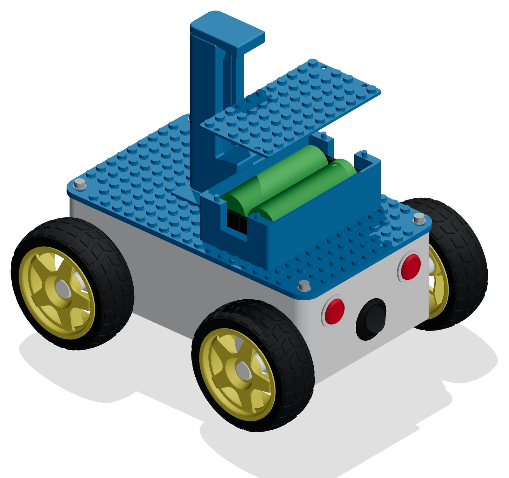
  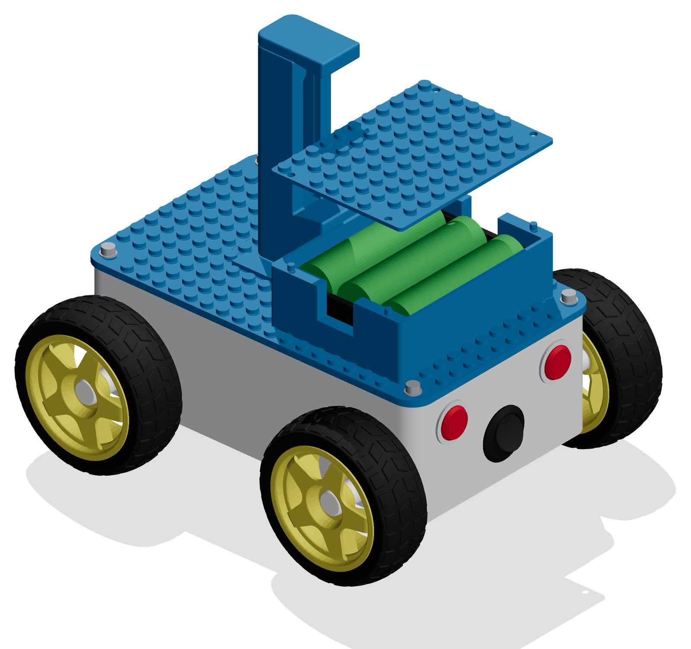
  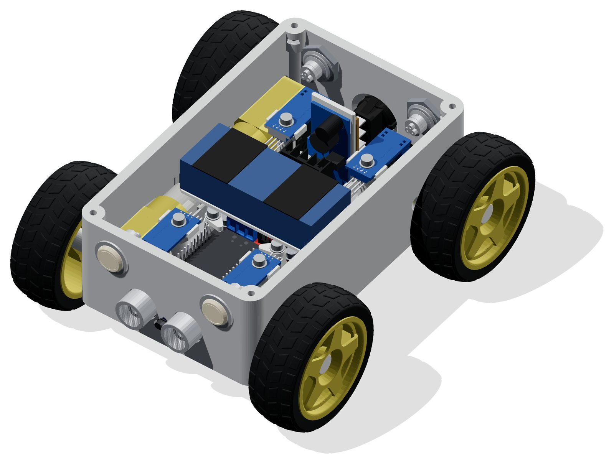
</p>

**A y B – caja de batería sobre la tapa.** La caja se encaja como una pieza de LEGO sobre los tetones de la tapa, detrás del soporte de teléfono. Su fondo tiene un canal que lleva los cables de la batería hacia abajo a través de la abertura trasera de la tapa. Coloca el portapilas en la caja con los cables en el extremo del canal. Pasa los cables por la abertura del fondo y el [lid_grommet](cad/stl/lid_grommet.stl) hasta el chasis, y luego presiona la tapa con tetones sobre los cuatro pivotes. La tapa también tiene tetones, así que las piezas de LEGO siguen encajando encima. La caja no interfiere con los tornillos de las esquinas de la tapa. La caja 3S queda completamente sobre la tapa, a 14 mm del borde trasero. Los cuatro tornillos de la tapa siguen siendo accesibles con la caja montada.

**C – bandeja LiPo interior.** La bandeja se apoya sobre dos patas en los huecos entre los motores y queda justo encima del L298N y de los ganchos del soporte del ESP32. La altura de la batería y la tapa cerrada la mantienen en su sitio. Sujeta la batería a la bandeja con una cinta de velcro de 20 mm pasada por las cuatro ranuras. Si la batería mide menos de 18 mm de grosor, añade una almohadilla de espuma encima para que no vibre. Haz primero todo el cableado del L298N: la bandeja tapa sus bornes, pero se saca recta hacia arriba.

> **Seguridad con litio.** Usa celdas de un distribuidor fiable. Protege los packs 18650 con una placa de protección (BMS). Conecta una alarma de tensión a la LiPo, porque ni el firmware ni la batería se desconectan cuando se agota. Instala un fusible cerca de la batería. Carga las LiPo solo con un cargador con balanceo, sobre una superficie no inflamable y nunca sin vigilancia. No uses una batería hinchada o dañada.

## Hardware y electrónica que comprar

**Solo hacen falta dos longitudes de tornillo: M3 × 10 mm y M3 × 25 mm**, ambas de cabeza alomada con unos 5,5 mm de diámetro de cabeza (sin cabeza avellanada). Las arandelas de las placas son impresas. No pongas arandelas bajo los tornillos de la tapa ni del soporte del ESP32, porque sus longitudes suponen que la cabeza apoya directamente en el plástico.

Los enlaces de abajo llevan a un proveedor o a una búsqueda en Amazon US. Comprueba las medidas y valores indicados antes de pedir, porque placas vendidas con el mismo nombre pueden tener distintos patrones de agujeros.

### Tornillería

| Cant. | Pieza | Uso | Comprar |
|---:|---|---|---|
| 19 (+ repuestos) | Insertos roscados de latón M3 × 5,7 mm para inserción en caliente, tamaño habitual de 4,6 mm de diámetro exterior (p. ej. ruthex RX-M3x5.7) | 14 en el chasis, 5 en el soporte de teléfono | [ruthex](https://www.ruthex.de/products/ruthex-gewindeeinsatz-m3-100-stuck-rx-m3x5-7-messing-gewindebuchsen) |
| 15 | Tornillos de cabeza alomada M3 × 10 mm | 4 tapa, 2 soporte, 4 L298N, 5 soporte de teléfono | [búsqueda](https://www.amazon.com/s?k=M3+x+10+pan+head+screws+ISO+7045) |
| 12 | Tornillos de cabeza alomada M3 × 25 mm | 8 motores, 4 sensores de velocidad (+2 para el soporte de teléfono fijo) | [búsqueda](https://www.amazon.com/s?k=M3+x+25+pan+head+screws+ISO+7045) |
| 8 | Tuercas hexagonales M3, 5,5 mm entre caras, ≈ 2,4 mm de grosor | 8 motores (+2 para el soporte de teléfono fijo) | [búsqueda](https://www.amazon.com/s?k=M3+hex+nuts+DIN+934) |
| 4 | Bridas pequeñas (≤ 3 mm de ancho) | Convertidor de 5 V y placa perforada en el soporte de las placas de alimentación | [búsqueda](https://www.amazon.com/s?k=small+cable+ties+2.5mm) |
| ≈ 350 g | PLA de 1,75 mm | todas las piezas impresas | [búsqueda](https://www.amazon.com/s?k=PLA+filament+1.75mm) |

### Electrónica y tracción

| Cant. | Pieza | Especificación / notas | Comprar |
|---:|---|---|---|
| 1 | ESP32 DevKit V1, 30 pines | Placa de unos 27,94 × 50,97 mm. Comprueba la posición de los agujeros, porque los clones de DevKit varían. | [búsqueda](https://www.amazon.com/s?k=ESP32+DevKit+V1+30+pin+development+board) |
| 1 | Módulo controlador L298N | Unos 43,5 × 43,5 mm con agujeros en un cuadrado de 37 × 37 mm. | [búsqueda](https://www.amazon.com/s?k=L298N+motor+driver+module+43+43) |
| 4 | Motorreductores TT de doble eje | Un eje mueve la rueda y el otro el disco del codificador. Para un cuerpo de motor de 53,35 mm. Elige una tensión nominal adecuada a tu opción de batería. | [búsqueda](https://www.amazon.com/s?k=TT+dual+shaft+gear+motor+robot+car) |
| 4 | Ruedas TT | ≈ 65 mm de diámetro | [búsqueda](https://www.amazon.com/s?k=65mm+TT+motor+robot+car+wheels) |
| 4 | Sensores ópticos de velocidad LM393 | Placa de ≈ 14,2 mm de ancho y ≈ 38,1 mm de largo, con un agujero de 3 mm. Se montan los cuatro; por defecto el firmware lee la pareja delantera. | [búsqueda](https://www.amazon.com/s?k=LM393+optical+speed+sensor+module+encoder+disk) |
| 4 | Discos de codificador | Solo si no los imprimes; deben encajar en el eje TT y en la ranura del sensor | [búsqueda](https://www.amazon.com/s?k=TT+motor+optical+encoder+disk) |
| 1 | Sensor de ultrasonidos HC-SR04 | Placa de 45,5 × 20,5 mm, transductores separados 25,5 mm (de centro a centro) | [búsqueda](https://www.amazon.com/s?k=HC+SR04+ultrasonic+sensor+module) |
| 1 | Interruptor basculante redondo | Encaja en el agujero del panel trasero; apto para la tensión de la batería y la corriente de los motores | [búsqueda](https://www.amazon.com/s?k=20mm+round+rocker+switch+SPST+DC) |
| 1 | Convertidor de 5 V, ≥ 2 A, máx. 21 × 43 × 14 mm | Encaja en el soporte de las placas de alimentación. Para 3S sirve un módulo LM2596. Para 2S, elige un tipo que siga dando 5 V con 6 V de entrada (p. ej. MP1584 o buck-boost). | [búsqueda](https://www.amazon.com/s?k=5V+buck+converter+2A+module) |
| 1 | Placa perforada pequeña, máx. 24 × 34 mm | Divisores de batería y de eco, control de las luces; va en la parte trasera del soporte | [búsqueda](https://www.amazon.com/s?k=small+prototype+perfboard) |
| 1 juego | Resistencias del 1 % | Divisor de batería 30 k + 10 k; divisor de eco 10 k + 20 k; luces 4 × 1 k + 4 × 100 k | [búsqueda](https://www.amazon.com/s?k=1+percent+metal+film+resistor+assortment+10k+20k+30k+1k+100k) |
| 2 + 2 | Pilotos de panel blancos y rojos *(opcional)* | La rosca de 12 mm encaja en `led_adapter_12mm`; para pilotos de 10, 8 o 6 mm imprime el adaptador correspondiente. Comprueba la tensión de los pilotos | [búsqueda](https://www.amazon.com/s?k=12mm+panel+LED+indicator+12V+white+red) |
| 4 | Transistores NPN, p. ej. PN2222A *(opcional, para las luces)* | Interruptor en el lado de masa para cada piloto | [búsqueda](https://www.amazon.com/s?k=PN2222A+transistor) |
| 1 juego | Cables Dupont, cable de alimentación de silicona, termorretráctil | Dimensiona el cable de alimentación para la corriente de bloqueo de los motores | [búsqueda](https://www.amazon.com/s?k=silicone+wire+kit+20+22+AWG+heat+shrink) |

### Batería y carga

Compra los elementos de la [opción de batería](#opciones-de-batería) que hayas elegido.

| Opción | Piezas | Comprar |
|---|---|---|
| A – Caja 2S | 2 celdas 18650 emparejadas, portapilas de 2 celdas en **serie** (≈ 77 × 41 mm), placa de protección 2S, fusible en línea (≈ 5 A), par XT30, cargador de Li-ion | [celdas](https://www.18650batterystore.com/collections/18650-batteries) · [portapilas](https://www.amazon.com/s?k=2+x+18650+battery+holder+series+wires) · [BMS/fusible/XT30](https://www.amazon.com/s?k=2S+BMS+18650+fuse+holder+XT30) · [cargador](https://www.amazon.com/s?k=18650+lithium+ion+battery+charger+independent+slots) |
| B – Caja 3S | 3 celdas 18650 emparejadas, portapilas de 3 celdas en **serie** (≈ 76 × 62 mm), placa de protección 3S, fusible en línea, par XT30, cargador de Li-ion | [celdas](https://www.18650batterystore.com/collections/18650-batteries) · [portapilas](https://www.amazon.com/s?k=3+series+18650+battery+holder) · [BMS/fusible/XT30](https://www.amazon.com/s?k=3S+lithium+battery+protection+BMS+fuse+holder+XT30+connector) · [cargador](https://www.amazon.com/s?k=18650+lithium+ion+battery+charger+independent+slots) |
| C – Bandeja LiPo | LiPo 2S o 3S de hasta 75 × 31 × 20 mm con XT30, cinta de velcro de 20 mm, cargador LiPo con balanceo, alarma de tensión LiPo | [LiPo](https://www.amazon.com/s?k=3S+650mAh+lipo+XT30) · [cinta](https://www.amazon.com/s?k=20mm+battery+strap+hook+loop) · [cargador](https://www.amazon.com/s?k=lipo+balance+charger+2S+3S) |

### Otros

| Cant. | Pieza | Notas | Comprar |
|---:|---|---|---|
| 1 | Goma elástica o muelle ligero | Tensa la pinza del teléfono | [búsqueda](https://www.amazon.com/s?k=rubber+bands+assorted+sizes) |
| 1 | Cable de datos micro-USB acodado a 90° | Para flashear sin desmontar y para la conexión por cable con el teléfono a través de la tapa. Un conector recto no cabe junto al L298N (ver [paso 6](#6-configurar-el-firmware-y-prueba-en-banco)). Elige el conector de tu placa (micro-USB o USB-C). | [búsqueda](https://www.amazon.com/s?k=90+degree+micro+USB+data+cable+up+down+angle) |
| 1 | Bloqueador de alimentación USB / adaptador solo datos *(solo para la conexión por cable con el teléfono)* | Evita que el teléfono y el convertidor de 5 V se alimenten entre sí | [búsqueda](https://www.amazon.com/s?k=USB+data+only+power+blocker+adapter) |
| 1 | Teléfono Android | Debe poder ejecutar la app OpenBot. Comprueba que cabe en el soporte con su funda. | – |
| – | Herramientas | Soldador con control de temperatura y punta para insertos M3, destornillador/llaves Allen, multímetro, alicate de corte, pelacables | [búsqueda](https://www.amazon.com/s?k=heat+set+insert+soldering+iron+tip+M3) |

## Montaje

<p align="center">
  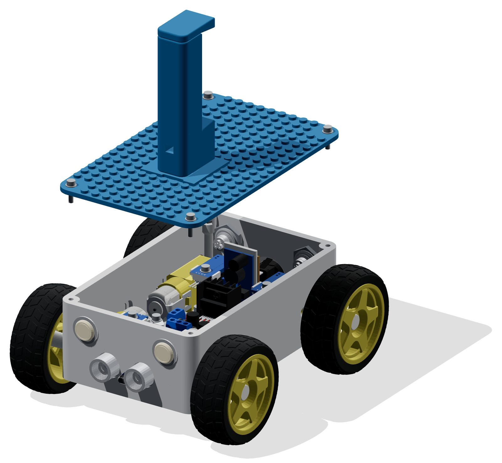
</p>

### 1. Colocar los insertos

<p align="center">
  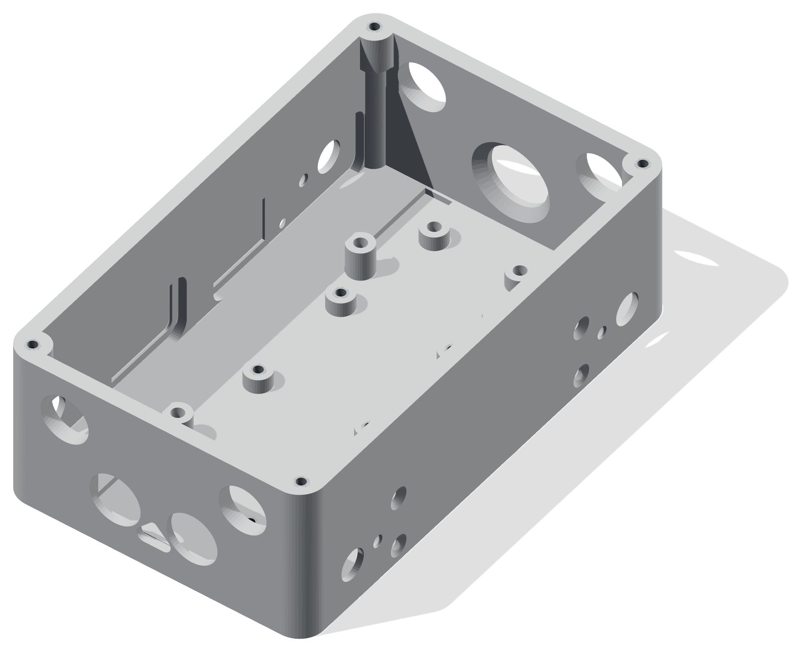
</p>

Usa insertos roscados estándar M3 × 5,7 mm (por ejemplo ruthex RX-M3x5.7, 4,6 mm de diámetro exterior) en los agujeros guía de 4,0 mm. Introduce cada inserto recto y a ras con un soldador con control de temperatura y una punta para insertos. Déjalo enfriar antes de atornillar en él.

Coloca **14 insertos en el chasis**:

- 4 en los resaltes del L298N
- 4 en los resaltes de los sensores de velocidad
- 2 en la pareja **delantera** de resaltes para placa larga (sujetan el soporte del ESP32)
- 4 en los postes de las esquinas, arriba en las paredes (sujetan la tapa)

Deja vacíos los dos resaltes traseros para placa larga, porque solo los usa la [placa alternativa](#placa-alternativa-con-controlador-integrado).

### 2. Montar los motores y los sensores de velocidad

<p align="center">
  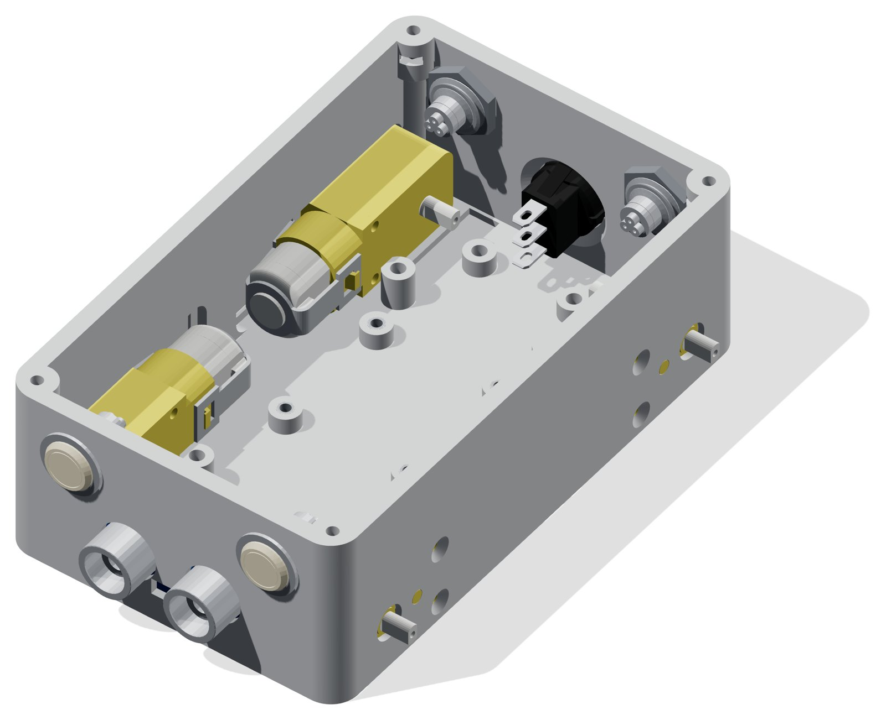
  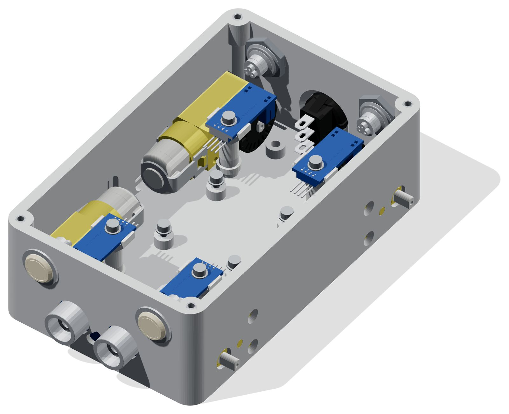
</p>

Coloca los cuatro motores TT con los ejes de las ruedas por las aberturas laterales y los cables hacia el centro. Fija cada motor con dos tornillos M3 × 25 mm y tuercas. Asegúrate de que los tornillos no tocan el interior de la reductora. **No pongas las ruedas** hasta terminar la prueba en banco.

Encaja un disco de codificador en cada eje interior. Coloca un soporte de sensor sobre cada uno de los cuatro resaltes de sensor, con el lado plano hacia el motor. El encaje en forma de D impide que gire. Asienta la placa LM393 entre las dos guías superiores y fíjala con una arandela impresa y un tornillo M3 × 25 mm.

Gira cada eje a mano. El disco debe pasar por la ranura óptica sin rozar, y las patillas del sensor no deben tocarlo.

### 3. Fijar el sensor de ultrasonidos y las piezas del frontal

<p align="center">
  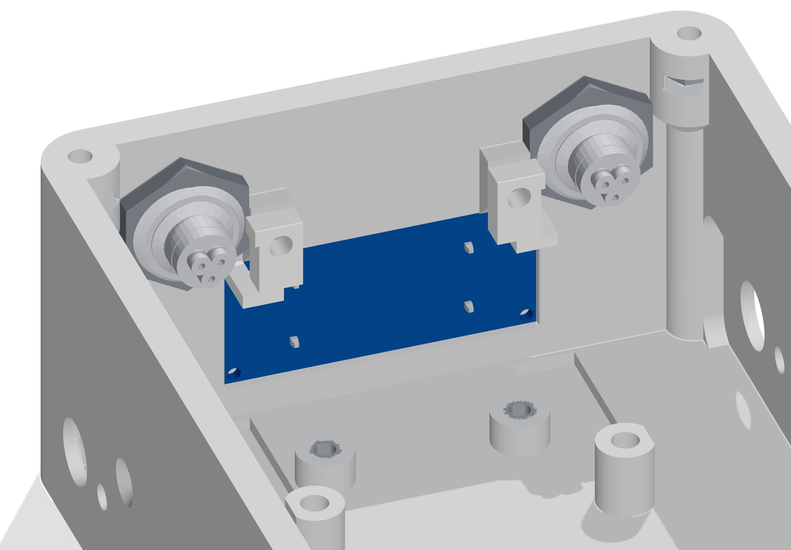
</p>

Empuja el HC-SR04 recto hacia el hueco delantero desde dentro, con los dos transductores por las aberturas redondas, hasta que los dos brazos flexibles de sus extremos encajen sobre sus esquinas superiores. El hueco sitúa la placa, y los brazos impiden que caiga hacia el chasis. Para sacarla, empuja hacia fuera la parte superior de los dos brazos y tira de la placa hacia atrás.

Monta las dos luces blancas delanteras, las dos luces rojas traseras (cada una en el adaptador LED impreso que corresponde a su rosca) y el interruptor basculante redondo con la tornillería que traen. Lleva los cables lejos de las ruedas y de los discos de codificador.

### 4. Montar el ESP32 y el controlador de motores

**Flashea primero el firmware** ([paso 6](#6-configurar-el-firmware-y-prueba-en-banco)) si no tienes un cable USB acodado. Una vez montado el L298N, un conector USB recto ya no entra en el ESP32.

Atornilla el soporte del ESP32 a los dos resaltes delanteros para placa larga con dos tornillos M3 × 10 mm; su base apoya plana en el suelo del chasis. Presiona el ESP32 sobre los cuatro pivotes de centrado de 2,2 mm a través de sus propios agujeros de montaje hasta que los cuatro ganchos de las esquinas encajen sobre la placa. Ningún tornillo atraviesa la placa del ESP32. Para sacar la placa, empuja hacia fuera los dos ganchos de un extremo y levanta ese extremo. Si los agujeros de tu placa no coinciden con los pivotes, no la fuerces.

Coloca los cuatro separadores impresos de 2,4 mm en los resaltes del L298N, pon el controlador encima y fija cada esquina con una arandela impresa de 0,8 mm y un tornillo M3 × 10 mm (patrón de 37 × 37 mm). Comprueba que las soldaduras de debajo no tocan el chasis y que el disipador tiene espacio para ventilar.

**Soporte de las placas de alimentación.** Sujeta el convertidor de 5 V en la parte delantera del soporte y la placa perforada del divisor en la trasera, cada uno con dos bridas por las ranuras. El soporte se apoya en el suelo detrás del disipador del L298N, entre los dos sensores de velocidad traseros y delante del interruptor. La tapa cerrada lo mantiene abajo, así que no necesita tornillos.

<p align="center">
  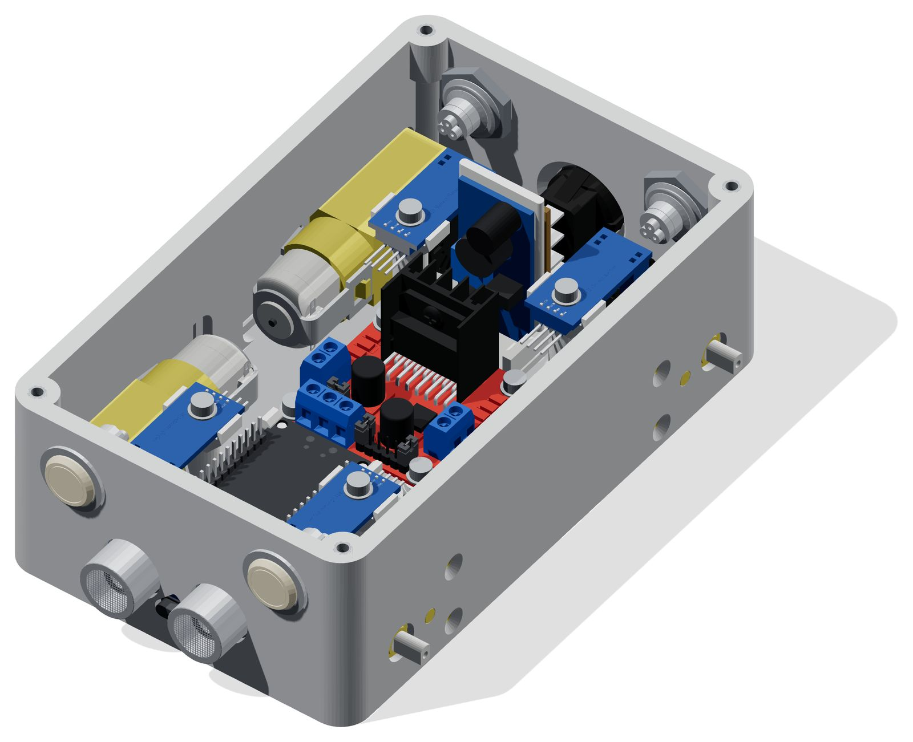
</p>

### 5. Cablear la alimentación y las señales

<p align="center">
  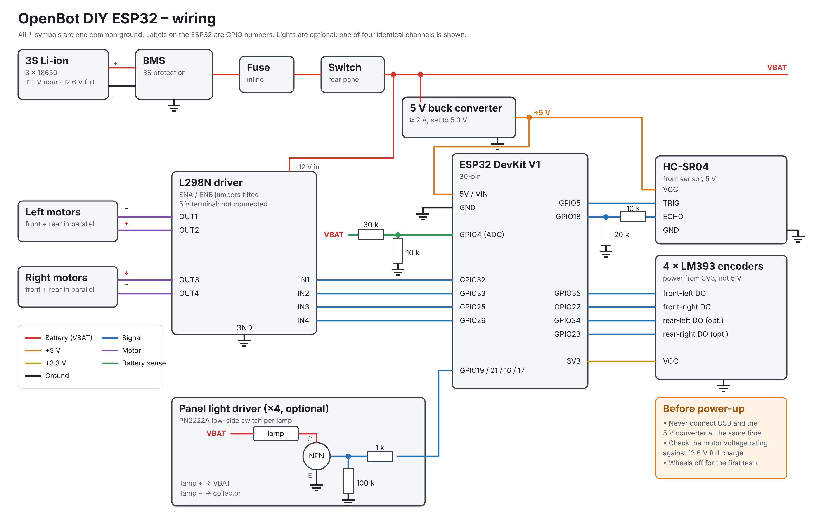
</p>

Usa los números de GPIO impresos en el ESP32. Todas las masas deben estar unidas. Mantén el cableado lejos de los engranajes, los discos de codificador, las puntas de los tornillos y la junta de la tapa, y sujétalo contra las vibraciones.

| Conexión | GPIO del ESP32 | Notas |
|---|---|---|
| L298N IN1 / IN2 (motores izquierdos) | 32 / 33 | |
| L298N IN3 / IN4 (motores derechos) | 25 / 26 | |
| L298N ENA / ENB | – | Deja puestos los puentes de habilitación (la velocidad se ajusta por PWM en los pines IN) |
| Codificador delantero izquierdo / delantero derecho | 35 / 22 | |
| Codificador trasero izquierdo / trasero derecho *(opcional)* | 34 / 23 | |
| Ultrasonidos TRIG | 5 | |
| Ultrasonidos ECHO | 18 | a través de un divisor de 10 k (ECHO → GPIO18) / 20 k (GPIO18 → GND) |
| Tensión de la batería | 4 | 30 k desde el + de la batería tras el interruptor hasta GPIO4, 10 k de GPIO4 a GND |
| Luces delanteras I / D *(opcional)* | 19 / 21 | a través de etapas con transistor NPN |
| Luces traseras I / D *(opcional)* | 16 / 17 | a través de etapas con transistor NPN, requiere cambio en el firmware |

- **Motores:** conecta los dos motores izquierdos en paralelo a OUT1/OUT2, + (rojo) a OUT2 y − (negro) a OUT1. Conecta los dos motores derechos a OUT3/OUT4, + (rojo) a OUT3 y − (negro) a OUT4. Los dos lados están reflejados, así ambos avanzan. Si un lado aún gira al revés, intercambia los dos cables de motor de ese lado.
- **Codificadores:** alimenta las placas LM393 con **3,3 V**, no con 5 V. Sus resistencias pull-up integradas mantienen entonces las salidas a un nivel seguro para el ESP32. GPIO34 y GPIO35 son solo de entrada y no tienen pull-up interno.
- **Luces:** cada piloto se conmuta con un transistor NPN (resistencia de base de 1 k, pull-down de 100 k entre base y emisor). Nunca alimentes un piloto directamente desde un pin del ESP32.

#### Alimentación

Positivo de la batería → placa de protección/BMS → fusible → interruptor → alimentación de motores del L298N (borne de +12 V). El convertidor de 5 V toma la tensión de la batería tras el interruptor y alimenta el pin 5 V/VIN del ESP32 y el HC-SR04. Deja sin conectar el borne de 5 V del L298N. **Nunca conectes el USB y la alimentación externa de 5 V a la vez**, salvo que haya un bloqueador de alimentación USB en el cable. Mantén la batería desconectada mientras montas.

Con la opción A (2S), los motores reciben unos 6,4 V, adecuados para los motores TT habituales de 3–6 V. Con la opción B o una LiPo 3S reciben unos 10,6 V. Usa motores preparados para esa tensión o limita la velocidad en la app.

### 6. Configurar el firmware y prueba en banco

Descarga el firmware de la [carpeta del firmware](../../firmware/README.es-ES.md) y abre `firmware/openbot/openbot.ino`.

1. Define el tipo de robot y deja activado el modo teléfono:

   ```cpp
   #define OPENBOT DIY_ESP32
   #define NO_PHONE_MODE 0
   ```

2. En el bloque `#elif (OPENBOT == DIY_ESP32)`, **desactiva los indicadores**. Sus pines por defecto (5 y 18) son los del sonar en este montaje:

   ```cpp
   #define HAS_INDICATORS 0   // default is 1
   ```

3. En el mismo bloque, ajusta los límites de batería para tu opción. El factor del divisor no cambia.

   | Opción | `VOLTAGE_LOW` | `VOLTAGE_MAX` |
   |---|---:|---:|
   | A – 18650 2S o LiPo 2S | 6.8f | 8.4f |
   | B – 18650 3S o LiPo 3S | 10.2f | 12.6f |

   El indicador de batería de la app va de `VOLTAGE_LOW` (vacía) a `VOLTAGE_MAX` (llena). Deja `VOLTAGE_MIN` como está: el firmware solo lo usa para la velocidad mínima de los motores cuando `NO_PHONE_MODE` está activado. El firmware nunca corta los motores por baja tensión, así que la placa de protección (opciones A y B) o una alarma de tensión LiPo (opción C) debe proteger las celdas.

4. Opcional, en el mismo bloque:

   ```cpp
   #define HAS_SPEED_SENSORS_BACK 1   // read the rear encoders as well
   #define HAS_LEDS_FRONT 1           // white lights on GPIO19/21 (default pins)
   #define HAS_LEDS_BACK 1            // red lights, and change their pins:
   const int PIN_LED_LB = 16;         // default 5
   const int PIN_LED_RB = 17;         // default 18
   ```

5. En el Arduino IDE, instala el **paquete de placas esp32 2.0.17**. El firmware usa `ledcSetup`/`ledcAttachPin`, que se eliminaron en la versión 3.x. Después selecciona **ESP32 Dev Module** y sube el programa.

**Acceso USB.** El ESP32 va boca abajo en su soporte, así que su conector USB queda bajo la placa, frente al borne de alimentación del L298N, a solo unos 8,5 mm. Con el controlador montado solo cabe un conector acodado, con el cable saliendo hacia arriba entre las dos placas. Flashea antes de montar el L298N o usa un cable de 90°.

Los pines de los motores no son pines de arranque del ESP32, así que los motores no se mueven al encender. Solo el GPIO 5 (disparo del sonar) es un pin de arranque. Si la placa no arranca o no se deja flashear con todo conectado, desconecta el disparo del sonar y vuelve a intentarlo.

**Prueba en banco** (sin ruedas, chasis elevado, monitor serie a 115200 baudios):

| Enviar | Resultado esperado |
|---|---|
| `f` | Una cadena de funciones que indica `DIY_ESP32` |
| *(observar la salida)* | Una tensión de batería y una distancia de sonar razonables |
| `c60,0`, luego `c0,0` | Solo gira el lado izquierdo, hacia delante |
| `c0,60`, luego `c0,0` | Solo gira el lado derecho, hacia delante |

Mientras giran las ruedas, comprueba que cambian los recuentos de los codificadores. Para de inmediato si un disco roza, un cable se calienta o el ESP32 se reinicia.

Instala la app de Android **OpenBot Robot**. Elige **Bluetooth**, concede los permisos que pida, busca `OpenBot` y conéctate. Para una conexión por cable, consulta el paso siguiente.

### 7. Montar la batería, el soporte de teléfono y la tapa

<p align="center">
  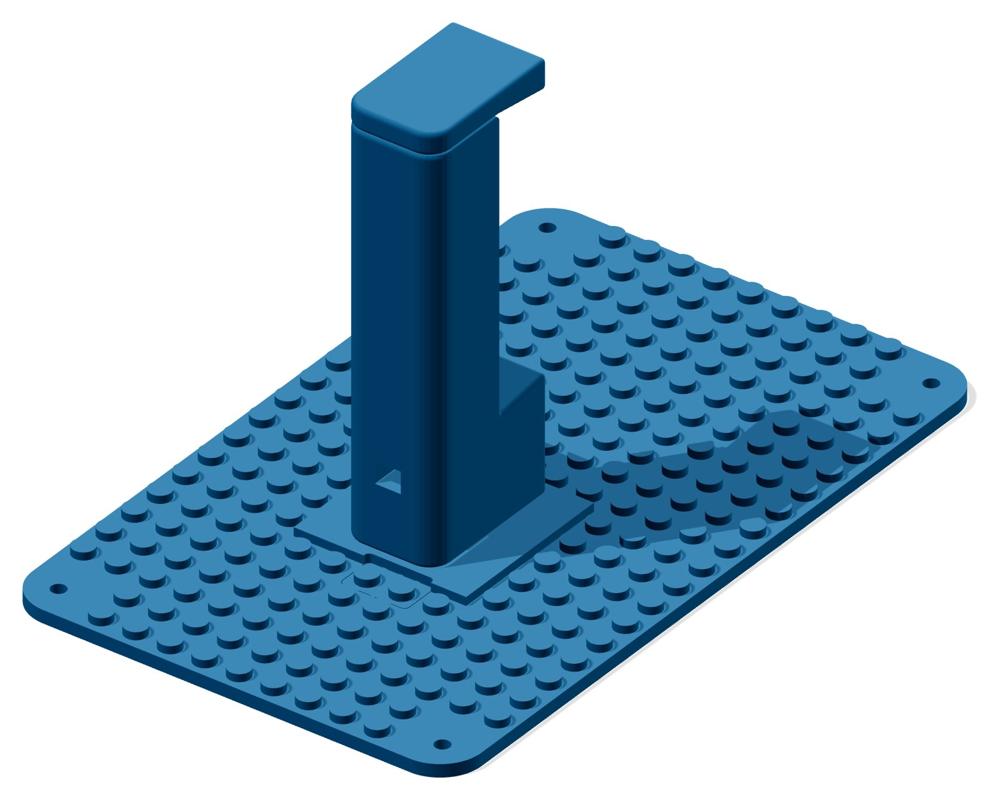
  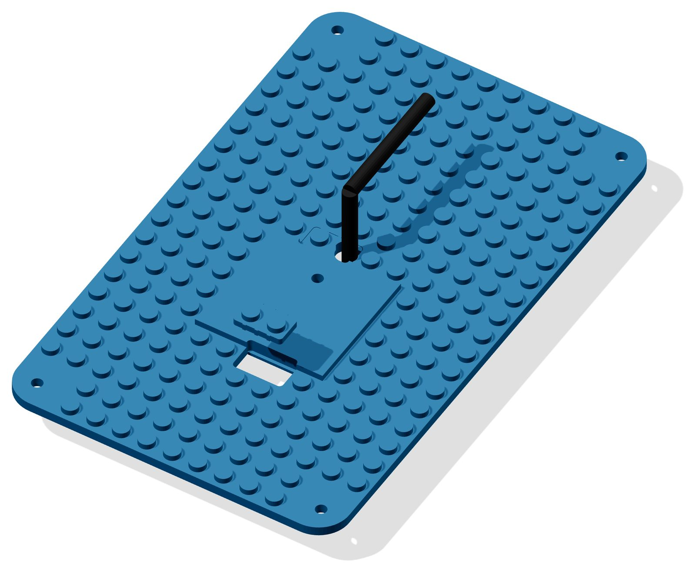
  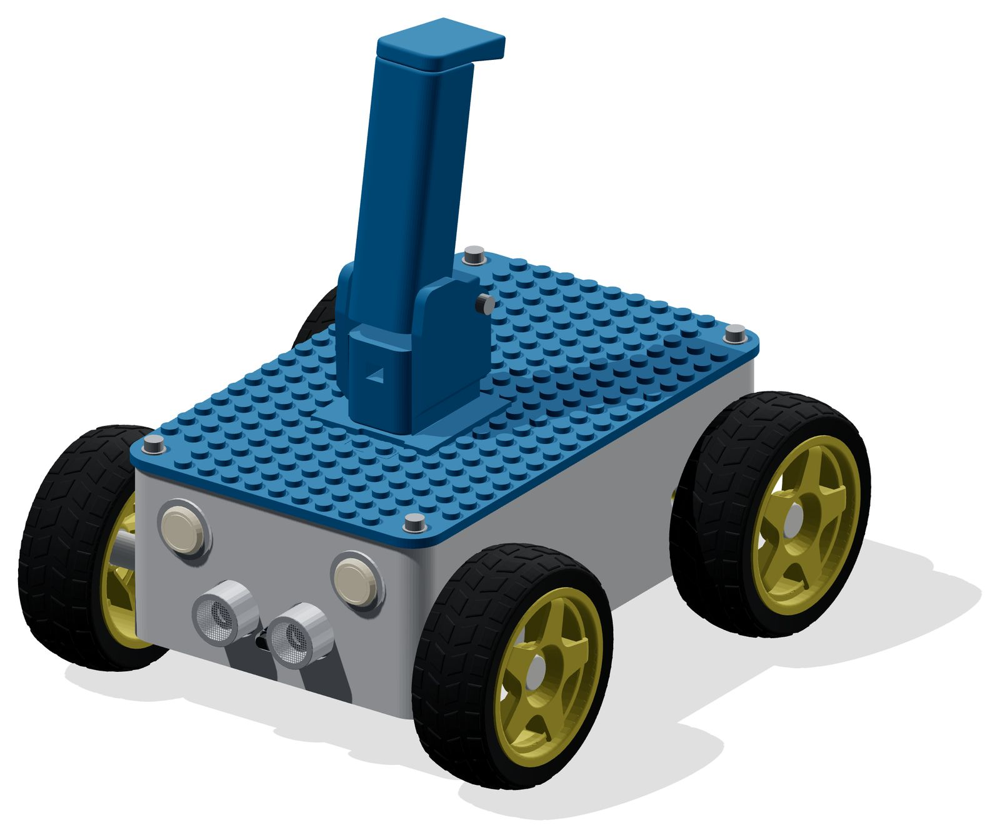
</p>

**Soporte de teléfono.** El soporte se inclina, así que la cámara también puede mirar hacia arriba, por ejemplo a una persona de pie delante del robot. Para que mire hacia abajo, atornilla el pie girado 180° y coloca el teléfono con la pantalla hacia la columna.

<p align="center">
  
  
</p>

1. Coloca tres insertos M3 en la columna, igual que en el paso 1: uno en cada extremo del agujero del eje, en la parte trasera, y uno en el agujero de bloqueo delantero, que solo está abierto por un lado.
2. Coloca dos insertos M3 en los agujeros de la base del pie. Atornilla el pie a la zona delantera de la tapa con dos tornillos M3 × 10 mm desde abajo.
3. Coloca la columna entre las mejillas con el agujero de bloqueo abierto hacia la mejilla que tiene cuatro agujeros. Atornilla un tornillo M3 × 10 mm a través de cada mejilla en los insertos del eje y apriétalos hasta que la columna gire sin holgura. Pon una gota de fijador de roscas de resistencia media (azul) en los dos tornillos del eje para que no se aflojen.
4. Inclina la columna hasta que su inserto de bloqueo coincida con uno de los tres agujeros de la mejilla: el más bajo da 0°, el del medio 15° y el más alto 30°. Bloquéala con el tercer tornillo M3 × 10 mm.
5. Monta la pinza deslizante y tensa con una goma elástica o un muelle. Con el teléfono en su funda, comprueba que queda bien sujeto, que la cámara tiene la vista despejada y que no se pulsa ningún botón.

A 30° sigue a unos 15 mm de la caja de batería. Si no necesitas la inclinación, imprime [phone_mount_bottom](../phone_mount/phone_mount_bottom.stl) en lugar del pie y la columna: introduce dos tuercas M3 en sus alojamientos y atorníllala a la zona de la tapa con dos tornillos M3 × 25 mm desde abajo. Usa la misma pinza, y el teléfono queda 10,5 mm más bajo.

**Aberturas de la tapa.** La tapa tiene dos aberturas de 1 × 2 tetones, una delante y otra detrás de la zona del teléfono. Coloca la tapa con la zona del teléfono hacia el sensor de ultrasonidos, en la parte delantera. La zona está 16 mm por delante del centro de la tapa; la zona de tetones trasera lleva la caja de la batería. Introduce un `lid_plug` en cada abertura sin usar; repone los tetones, y un reborde de 1 mm en la parte inferior de la abertura evita que se caiga. Donde pase un cable, usa en su lugar el `lid_grommet`:

- **Conexión por cable con el teléfono:** lleva un cable USB acodado de 90° desde el ESP32, hacia arriba por la abertura delantera, hasta el teléfono. Pon un bloqueador de alimentación USB en la línea para que el teléfono y el convertidor de 5 V no se alimenten entre sí. En la app, elige **USB** en lugar de Bluetooth.
- **Caja de batería (opciones A y B):** los cables de la batería bajan por la abertura trasera.

Monta ahora la bandeja LiPo si usas la opción C. Aparta los cables del borde, apoya la tapa plana sobre el chasis y atornilla cuatro tornillos M3 × 10 mm (sin arandelas) en los insertos de las esquinas. Apriétalos por igual hasta que asienten. La tapa no debe levantarse y el soporte no debe bailar. En las opciones A y B, encaja la caja de batería en los tetones detrás del soporte de teléfono.

Pon las ruedas solo cuando la prueba en banco sea correcta. Haz el primer recorrido despacio sobre un suelo despejado y nivelado, y después revisa todos los tornillos y la pinza del teléfono. Levanta el robot por el chasis, no por la tapa, el soporte de teléfono ni la caja de batería.

## Placa alternativa con controlador integrado

<p align="center">
  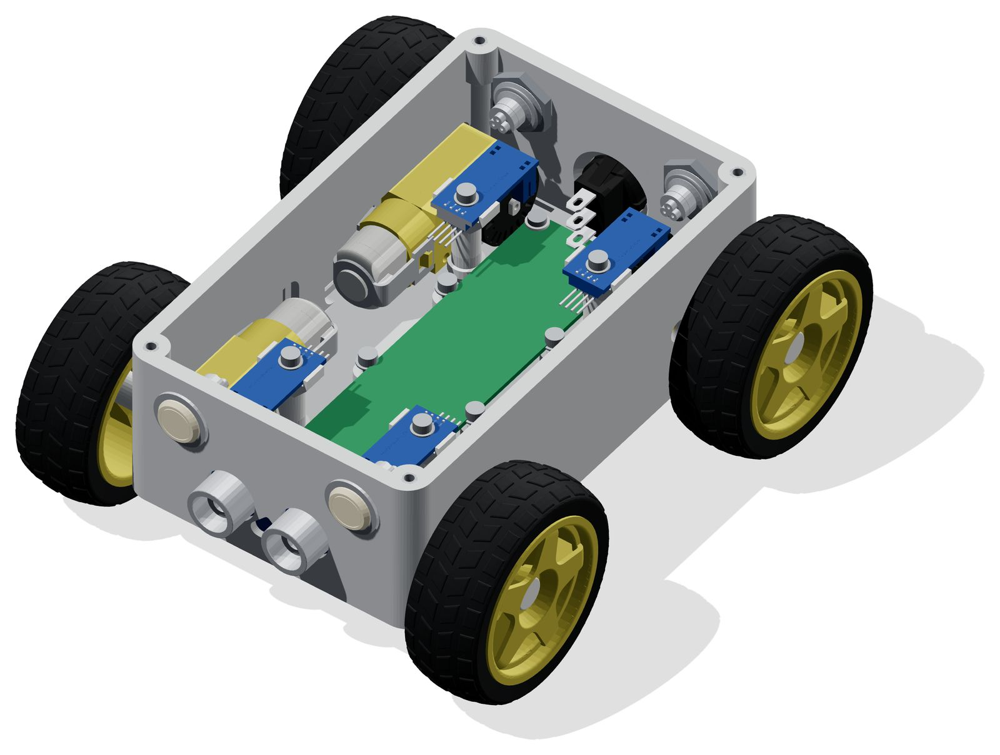
</p>

El chasis también admite la **PCB V2** de OpenBot (Arduino Nano + controladores DRV8871), que usa un patrón de montaje de 121,031 × 28,448 mm. Es un montaje eléctrico distinto y **no** un sustituto directo del ESP32. Funciona con el firmware `PCB_V2` y el cableado del Nano.

- Prescinde del soporte del ESP32, el L298N y el soporte de las placas de alimentación.
- Coloca 4 insertos en los cuatro resaltes para placa larga. Con los 4 insertos de los sensores, los 4 de la tapa y los 5 del soporte de teléfono, son **17 insertos en total**.
- Monta la placa sobre cuatro separadores impresos de 2,4 mm, con una arandela impresa y un tornillo M3 × 10 mm en cada agujero.
- Tornillería total: **13 × M3 × 10** (4 tapa, 4 placa, 5 soporte de teléfono), **12 × M3 × 25**, 8 tuercas.

Encarga la placa con los [archivos de fabricación y la lista de materiales de la PCB V2](../diy/pcb/v2), por ejemplo en [JLCPCB](https://jlcpcb.com/) o [PCBWay](https://www.pcbway.com/). Antes de fijarla, comprueba la altura de los componentes montados y la holgura de las soldaduras. Las opciones de batería anteriores funcionan igual con esta placa.

## Solución de problemas

| Síntoma | Comprobación |
|---|---|
| Errores de compilación sobre `ledcSetup` / `ledcAttachPin` | El núcleo esp32 es 3.x. Instala la 2.0.17. |
| El conector USB no entra en el ESP32 | El L298N estorba. Usa un conector de 90° o desmonta el controlador para flashear. |
| El ESP32 no arranca o no se flashea una vez cableado | Carga en el GPIO 5 (disparo del sonar). Desconéctalo y vuelve a intentarlo. |
| El ESP32 se reinicia al arrancar los motores | Batería débil o descargada, o un convertidor de 5 V que no regula a partir de 2S. Mide la línea de 5 V con carga. |
| Sonar siempre a 0 o errático | `HAS_INDICATORS` sigue en 1, o el divisor de eco falta o es incorrecto |
| Sin recuentos de un codificador | Sensor sin 3,3 V, disco fuera de la ranura o disco no opaco |
| El robot gira cuando debería ir recto | Los cables de motor de un lado están invertidos; intercambia la pareja en OUT1/OUT2 o en OUT3/OUT4 |
| Lectura de batería errónea o la app muestra «baja» | El divisor debe ser de 30 k (arriba) / 10 k (abajo), y los límites de tensión deben corresponder a tu opción |
| La tapa no asienta | Hay un cable atrapado en el borde, la LiPo es demasiado gruesa o un inserto de la tapa sobresale de su poste |
| La caja de batería queda suelta sobre la tapa | Los tetones impresos han salido pequeños. Sube un poco el flujo o comprueba la precisión dimensional de la impresora y vuelve a imprimir la caja |

## Vistas

| Delante | Detrás |
|---|---|
|  | 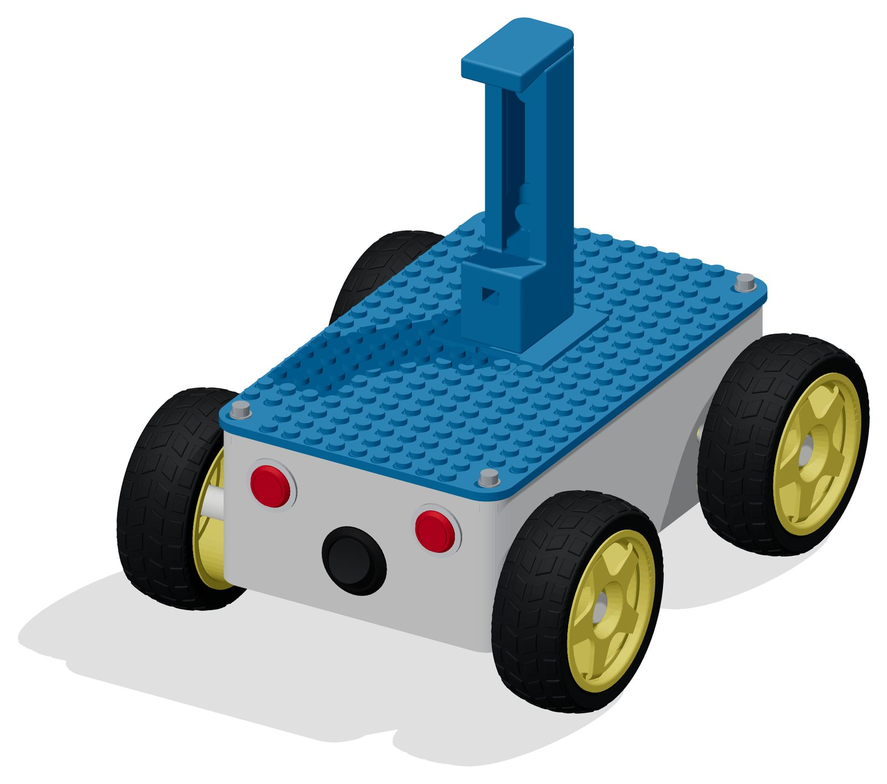 |
| **Arriba** | **Abajo** |
| 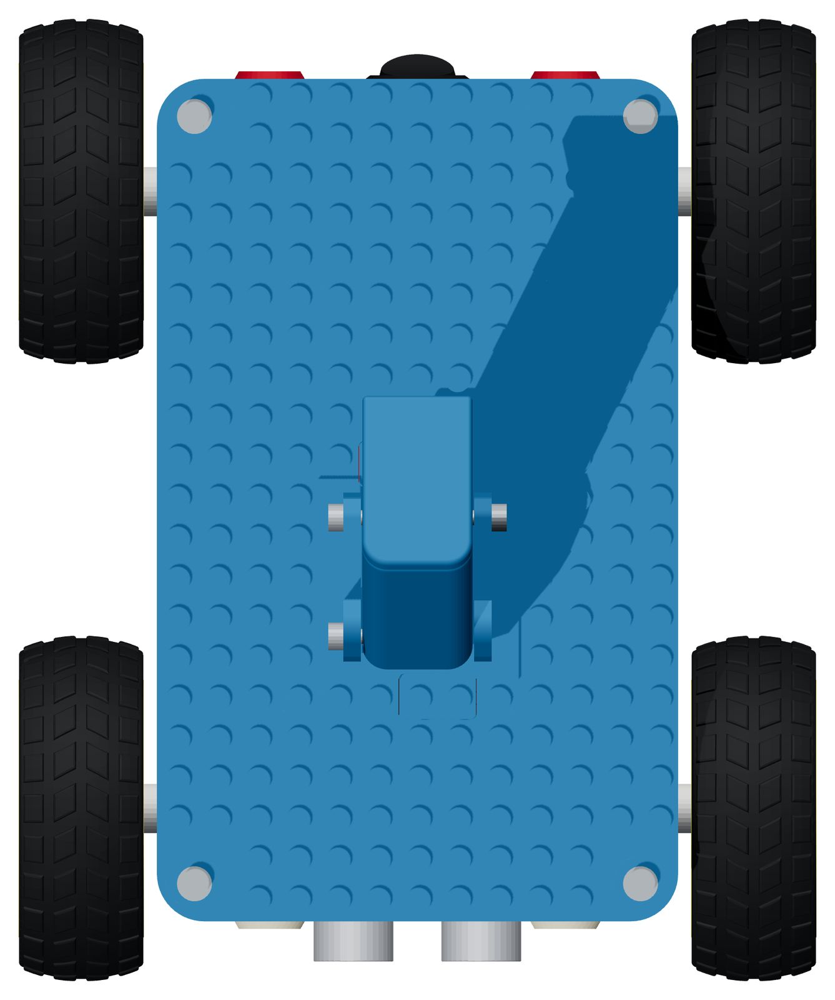 | 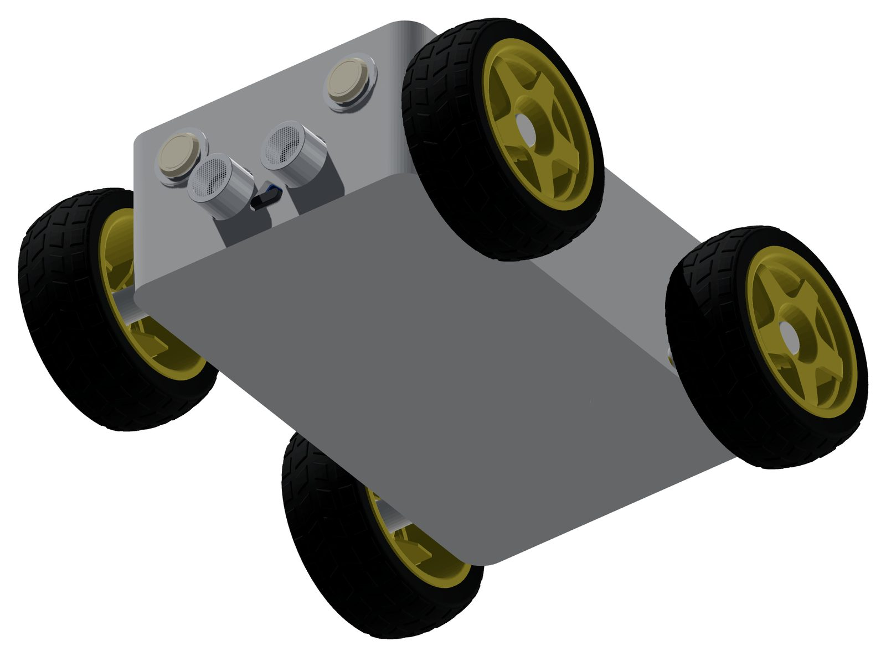 |

Los renders no incluyen el cableado. Las placas, los portapilas y la batería LiPo se muestran como formas simplificadas.

## Siguiente paso

Instala la [app OpenBot Robot](../../android/robot/README.es-ES.md) en tu teléfono y conéctala al robot como se describe en el [paso 6](#6-configurar-el-firmware-y-prueba-en-banco).
