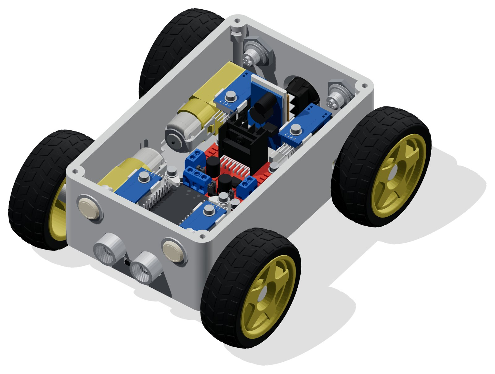

# OpenBot Compact

<p align="center">
  <a href="README.md">English</a> |
  <a href="README.zh-CN.md">简体中文</a> |
  <a href="README.de-DE.md">Deutsch</a> |
  <span>Français</span> |
  <a href="README.es-ES.md">Español</a> |
  <a href="README.ko-KR.md">한국어</a>
</p>

OpenBot Compact est un corps [OpenBot](../../README.fr-FR.md) compact à quatre roues pour une motorisation **ESP32 DevKit V1 + L298N**. Il possède un couvercle à tenons compatible LEGO, un capot vissé, un support de téléphone en deux pièces, des supports électroniques amovibles fixés par vis et trois options de batterie. Chaque pièce imprimée tient sur une **Bambu Lab A1 mini** (plus grande pièce 104 × 168 mm).

<p align="center">
  
</p>

| | |
|---|---|
| **Motorisation** | 4 × motoréducteurs TT à double arbre ; paire gauche et paire droite en parallèle sur un L298N |
| **Contrôleur** | ESP32 DevKit V1 (30 broches), firmware OpenBot `DIY_ESP32` ; liaison avec le téléphone par Bluetooth ou câble USB |
| **Capteurs** | Ultrason HC-SR04 (avant), 4 × encodeurs de roue optiques LM393, tension de la batterie |
| **Alimentation** | Au choix : boîtier 18650 2S ou 3S sur le couvercle, ou petite batterie LiPo à l'intérieur (voir [Options de batterie](#options-de-batterie)) |
| **Visserie** | Uniquement des vis à tête cylindrique bombée M3 × 10 et M3 × 25, des écrous M3 et 16 inserts filetés |
| **Impression** | PLA, deux plateaux A1 mini, ≈ 11 h et ≈ 300 g, plus les pièces de l'option de batterie choisie |

> **Gauche et droite** désignent toujours dans ce guide la gauche et la droite **du robot** : placez-vous derrière le robot (côté interrupteur) et regardez vers l'avant, par-dessus le couvercle, en direction du capteur à ultrasons. Le firmware utilise la même convention pour les moteurs et encodeurs « gauche » et « droit ».

## Sommaire

- [Pièces imprimées](#pièces-imprimées) · [Impression](#impression)
- [Options de batterie](#options-de-batterie)
- [Matériel et électronique à acheter](#matériel-et-électronique-à-acheter)
- Montage : [1 Inserts et écrous](#1-poser-les-inserts-et-les-écrous-du-couvercle) · [2 Moteurs et encodeurs](#2-monter-les-moteurs-et-les-capteurs-de-vitesse) · [3 Capteur à ultrasons et façade](#3-fixer-le-capteur-à-ultrasons-et-les-pièces-de-la-façade) · [4 ESP32 et pilote](#4-monter-lesp32-et-le-pilote-de-moteurs) · [5 Câblage](#5-câbler-lalimentation-et-les-signaux) · [6 Firmware et test sur table](#6-configurer-le-firmware-et-test-sur-table) · [7 Batterie, support de téléphone et couvercle](#7-monter-la-batterie-le-support-de-téléphone-et-le-couvercle)
- [Carte alternative avec pilote intégré](#carte-alternative-avec-pilote-intégré)
- [Dépannage](#dépannage) · [Vues](#vues) · [Ensuite](#ensuite)

## Pièces imprimées

<p align="center">
  
</p>

| Pièce | Qté | Emplacement / orientation d'impression |
|---|---:|---|
| [bottom_cover](cad/stl/bottom_cover.stl) ([STEP](cad/step/bottom_cover.step)) | 1 | Châssis ; fond vers le bas, sans supports |
| [top_cover](cad/stl/top_cover.stl) ([STEP](cad/step/top_cover.step)) | 1 | Couvercle à tenons avec deux ouvertures pour câbles ; face plane vers le bas, tenons vers le haut |
| [lid_plug](cad/stl/lid_plug.stl) ([STEP](cad/step/lid_plug.step)) | 2 | Ferme les ouvertures du couvercle et restitue les deux tenons. Tenons vers le haut. |
| [lid_grommet](cad/stl/lid_grommet.stl) ([STEP](cad/step/lid_grommet.step)) | 1 *(optionnel)* | Remplace un bouchon là où passe un câble. Tenons vers le haut. |
| [esp32_carrier](cad/stl/esp32_carrier.stl) ([STEP](cad/step/esp32_carrier.step)) | 1 | Cadre de support de l'ESP32 ; base plane vers le bas |
| [esp32_retainer](cad/stl/esp32_retainer.stl) ([STEP](cad/step/esp32_retainer.step)) | 4 | Pattes d'angle de l'ESP32 ; chaque patte va à n'importe quel angle. À plat, ergot vers le haut. |
| [sensor_support](cad/stl/sensor_support.stl) ([STEP](cad/step/sensor_support.step)) | 4 | Supports des capteurs de vitesse ; chaque support va sur n'importe quelle roue |
| [ultrasonic_clip_left](cad/stl/ultrasonic_clip_left.stl) ([STEP](cad/step/ultrasonic_clip_left.step)) | 1 | Coin supérieur **gauche** de la carte HC-SR04 |
| [ultrasonic_clip_right](cad/stl/ultrasonic_clip_right.stl) ([STEP](cad/step/ultrasonic_clip_right.step)) | 1 | Coin supérieur **droit** de la carte HC-SR04 |
| [power_board_stand](cad/stl/power_board_stand.stl) ([STEP](cad/step/power_board_stand.step)) | 1 | Porte le convertisseur 5 V et la plaque à trous du diviseur derrière le dissipateur. Base vers le bas. |
| [pcb_spacer](cad/stl/pcb_spacer.stl) ([STEP](cad/step/pcb_spacer.step)) | 4 | Entretoises isolantes de 2,4 mm sous le L298N |
| [pcb_washer](cad/stl/pcb_washer.stl) ([STEP](cad/step/pcb_washer.step)) | 8 | Rondelles isolantes de 0,8 mm : 4 pour le L298N, 4 pour les capteurs de vitesse |
| [phone_mount_bottom](cad/stl/phone_mount_bottom.stl) ([STEP](cad/step/phone_mount_bottom.step)) | 1 | Base du support de téléphone ; debout sur son pied, sans supports |
| [phone_mount_top](cad/stl/phone_mount_top.stl) ([STEP](cad/step/phone_mount_top.step)) | 1 | Pince coulissante du téléphone ; debout, sans supports |
| [led_adapter](cad/stl/led_adapter.stl) ([STEP](cad/step/led_adapter.step)) | 4 | Adaptateurs pour les voyants encastrés : 2 à l'avant, 2 à l'arrière |
| [encoder_disk](cad/stl/encoder_disk.stl) ([STEP](cad/step/encoder_disk.step)) | 4 | Optionnel ; imprimez en filament **opaque** ou utilisez des disques achetés compatibles. S'imprime à plat. |

Les quatre pattes de l'ESP32 sont identiques, tout comme les quatre supports de capteur ; chaque pièce va donc à n'importe quelle position. Les clips à ultrasons forment une paire gauche/droite symétrique. Imprimez-les couchés sur leur large face arrière. Les pièces de votre batterie sont listées dans [Options de batterie](#options-de-batterie).

## Impression

Les fichiers STL et STEP de toutes les pièces se trouvent dans [cad/stl](cad/stl) et [cad/step](cad/step), déjà orientés pour l'impression et en millimètres ; imprimez à l'échelle 100 %.

Ouvrez **[compact_A1_mini.3mf](cad/compact_A1_mini.3mf)** dans Bambu Studio. Les plateaux 1 et 2 contiennent toutes les pièces standard dans la quantité nécessaire. Les plateaux 3 à 5 contiennent chacun une option de batterie ; n'imprimez que celle que vous avez choisie.

| Plateau | Contenu | Durée* | Filament* |
|---|---|---:|---:|
| 1 – Châssis et accessoires | châssis, support de téléphone (les deux pièces), 4 supports de capteur, 4 adaptateurs LED, 2 disques d'encodeur, 2 pattes ESP32, clip à ultrasons droit, 2 entretoises, 6 rondelles | ≈ 7 h 50 min | ≈ 215 g |
| 2 – Couvercle et accessoires | couvercle à tenons, support ESP32, support des cartes d'alimentation, 2 bouchons de couvercle, 2 disques d'encodeur, 2 pattes ESP32, clip à ultrasons gauche, 2 entretoises, 2 rondelles | ≈ 3 h 20 min | ≈ 80 g |
| 3 – Batterie A (boîtier 2S) | boîtier de batterie 2S, son couvercle, passe-câble du couvercle | ≈ 1 h 40 min | ≈ 42 g |
| 4 – Batterie B (boîtier 3S) | boîtier de batterie 3S, son couvercle, passe-câble du couvercle | ≈ 2 h 20 min | ≈ 58 g |
| 5 – Batterie C (plateau LiPo) | plateau LiPo | ≈ 15 min | ≈ 5 g |

\*Estimations avec Generic PLA ; plateaux 3 à 5 extrapolés à partir du volume des pièces. Vos durées seront différentes. Cliquez sur **Slice plate** pour chaque plateau avant d'imprimer.

Profil : buse de 0,4 mm, couches de 0,20 mm, 4 parois, 5 couches supérieures et 5 inférieures, remplissage gyroïde 30 %, plateau PEI texturé. **Aucune pièce n'a besoin de supports.** Les trous des parois du châssis sont ronds et mesurent au plus 20 mm, et ses logements d'écrou forment des ponts d'environ 8 mm. Les deux pièces du support de téléphone s'impriment debout. Les supports sont désactivés dans le projet ; si vous ajoutez une pièce du dossier STL, laissez-les aussi désactivés. Avant d'imprimer, sélectionnez le PLA réellement chargé et vérifiez l'aperçu des couches.

- Le couvercle s'imprime à plat, tenons vers le haut. Le châssis s'imprime fond vers le bas, cavité ouverte.
- Après l'impression, retirez les fils des logements d'écrou (laissez en place les deux petites nervures à l'entrée de chaque logement), des trous d'insert, des emboîtements et des ouvertures pour câbles.
- Imprimez les rondelles de 0,8 mm à plat avec des couches de 0,20 mm. Elles isolent les cartes et répartissent la force des vis. Serrez seulement jusqu'au contact et remplacez toute rondelle déformée.
- Gardez les pièces en PLA à l'écart des voitures chaudes et du plein soleil d'été, car le PLA ramollit vers 55 °C.

## Options de batterie

Il n'y a pas de place dans le châssis pour un support 18650 à 3 cellules (76 × 62 × 20 mm). Tous les emplacements offrant 20 mm de hauteur sont trop étroits. Choisissez plutôt l'une de ces trois options :

| | **A – Boîtier 18650 2S** (recommandé) | **B – Boîtier 18650 3S** | **C – Plateau LiPo intérieur** |
|---|---|---|---|
| Emplacement | Sur le couvercle, derrière le support de téléphone | Sur le couvercle, derrière le support de téléphone | À l'intérieur, au-dessus du pilote de moteurs |
| Batterie | 2 × 18650 dans un support 2 cellules en série (≈ 77 × 41 × 20 mm) | 3 × 18650 dans un support 3 cellules en série (≈ 76 × 62 × 20 mm) | LiPo 2S ou 3S, **max. 75 × 31 × 20 mm** (p. ex. 3S 450–650 mAh, 2S 1000–1300 mAh) |
| Tension | 8,4 V chargée, 7,4 V nominale | 12,6 V chargée, 11,1 V nominale | 8,4 V ou 12,6 V chargée |
| Énergie | ≈ 21 Wh (2 × 2800 mAh) | ≈ 31 Wh (3 × 2800 mAh) | ≈ 5–10 Wh |
| Pièces imprimées | [battery_box_2s](cad/stl/battery_box_2s.stl) + [couvercle](cad/stl/battery_box_2s_cover.stl), 1 [lid_grommet](cad/stl/lid_grommet.stl) | [battery_box_3s](cad/stl/battery_box_3s.stl) + [couvercle](cad/stl/battery_box_3s_cover.stl), 1 [lid_grommet](cad/stl/lid_grommet.stl) | [lipo_tray](cad/stl/lipo_tray.stl) |
| Chargeur | Chargeur Li-ion à emplacements séparés | Chargeur Li-ion à emplacements séparés | Chargeur LiPo à **équilibrage** |
| Remarques | Le meilleur choix pour les moteurs TT : environ 6,4 V leur parviennent après la chute de tension du L298N. | Surtension pour des moteurs TT 3–6 V (≈ 10,6 V après le L298N). Utilisez des moteurs pour une tension plus élevée ou limitez la vitesse. | Plus petite capacité. La batterie est cachée et protégée. |

Les trois options conservent le diviseur de batterie 30 k / 10 k du firmware. Seules les limites de tension dans le firmware changent (voir [étape 6](#6-configurer-le-firmware-et-test-sur-table)).

<p align="center">
  
  
  
</p>

**A et B – boîtier de batterie sur le couvercle.** Le boîtier s'emboîte comme une brique LEGO sur les tenons du couvercle, derrière le support de téléphone. Son fond comporte un canal qui guide les fils de la batterie vers le bas à travers l'ouverture arrière du couvercle. Posez le support de piles dans le boîtier avec ses fils du côté du canal. Faites passer les fils par l'ouverture du fond et le [lid_grommet](cad/stl/lid_grommet.stl) jusque dans le châssis, puis enfoncez le couvercle à tenons sur les quatre ergots. Ce couvercle a lui aussi des tenons, donc des briques LEGO se fixent toujours dessus. Le boîtier ne gêne pas les vis du couvercle dans les coins. Le boîtier 3S reste entièrement sur le couvercle, à 14 mm du bord arrière. Les quatre vis du couvercle restent accessibles avec le boîtier en place.

**C – plateau LiPo intérieur.** Le plateau repose sur deux pieds dans les espaces entre les moteurs et se trouve juste au-dessus du L298N et des vis des pattes ESP32. La hauteur de la batterie et le couvercle fermé le maintiennent en place. Fixez la batterie au plateau avec une sangle auto-agrippante de 20 mm passée dans les quatre fentes. Si la batterie fait moins de 18 mm d'épaisseur, ajoutez une cale en mousse dessus pour qu'elle ne bouge pas. Faites d'abord tout le câblage du L298N : le plateau couvre ses bornes, mais se retire tout droit.

> **Sécurité lithium.** Utilisez des cellules d'un revendeur sérieux. Protégez les packs 18650 avec une carte de protection (BMS). Branchez une alarme de tension sur une LiPo, car ni le firmware ni la batterie ne coupent quand elle est vide. Installez un fusible près de la batterie. Chargez les LiPo uniquement avec un chargeur à équilibrage, sur une surface ininflammable et jamais sans surveillance. N'utilisez pas une batterie gonflée ou endommagée.

## Matériel et électronique à acheter

**Seules deux longueurs de vis sont nécessaires : M3 × 10 mm et M3 × 25 mm**, toutes deux à tête cylindrique bombée d'environ 5,5 mm de diamètre (pas de têtes fraisées). Les rondelles des cartes sont imprimées. N'ajoutez pas de rondelles sous les vis du couvercle, du support ou des pattes ESP32, car leurs longueurs supposent que la tête appuie directement sur le plastique.

Les liens ci-dessous mènent vers un fournisseur ou une recherche Amazon US. Vérifiez les dimensions et caractéristiques indiquées avant de commander, car des cartes vendues sous le même nom peuvent avoir des perçages différents.

### Visserie

| Qté | Pièce | Utilisation | Acheter |
|---:|---|---|---|
| 16 (+ réserve) | Inserts filetés en laiton M3 × 5,7 mm à insérer à chaud, taille courante de 4,6 mm de diamètre extérieur (p. ex. ruthex RX-M3x5.7) | 12 dans le châssis, 4 dans le support ESP32 | [ruthex](https://www.ruthex.de/products/ruthex-gewindeeinsatz-m3-100-stuck-rx-m3x5-7-messing-gewindebuchsen) |
| 16 | Vis à tête cylindrique bombée M3 × 10 mm | 4 couvercle, 2 support, 4 pattes ESP32, 4 L298N, 2 clips à ultrasons | [recherche](https://www.amazon.com/s?k=M3+x+10+pan+head+screws+ISO+7045) |
| 14 | Vis à tête cylindrique bombée M3 × 25 mm | 8 moteurs, 4 capteurs de vitesse, 2 support de téléphone | [recherche](https://www.amazon.com/s?k=M3+x+25+pan+head+screws+ISO+7045) |
| 14 | Écrous hexagonaux M3, 5,5 mm sur plats, ≈ 2,4 mm d'épaisseur | 4 couvercle, 8 moteurs, 2 support de téléphone | [recherche](https://www.amazon.com/s?k=M3+hex+nuts+DIN+934) |
| 4 | Petits colliers de serrage (≤ 3 mm de large) | Convertisseur 5 V et plaque à trous sur le support des cartes d'alimentation | [recherche](https://www.amazon.com/s?k=small+cable+ties+2.5mm) |
| ≈ 350 g | PLA 1,75 mm | toutes les pièces imprimées | [recherche](https://www.amazon.com/s?k=PLA+filament+1.75mm) |

### Électronique et motorisation

| Qté | Pièce | Caractéristiques / remarques | Acheter |
|---:|---|---|---|
| 1 | ESP32 DevKit V1, 30 broches | Carte d'environ 27,94 × 50,97 mm. Vérifiez la position des trous, car les clones de DevKit diffèrent. | [recherche](https://www.amazon.com/s?k=ESP32+DevKit+V1+30+pin+development+board) |
| 1 | Module pilote L298N | Environ 43,5 × 43,5 mm avec des trous sur un carré de 37 × 37 mm. | [recherche](https://www.amazon.com/s?k=L298N+motor+driver+module+43+43) |
| 4 | Motoréducteurs TT à double arbre | Un arbre entraîne la roue, l'autre le disque d'encodeur. Convient à un corps de moteur de 53,35 mm. Choisissez une tension nominale adaptée à votre option de batterie. | [recherche](https://www.amazon.com/s?k=TT+dual+shaft+gear+motor+robot+car) |
| 4 | Roues TT | ≈ 65 mm de diamètre | [recherche](https://www.amazon.com/s?k=65mm+TT+motor+robot+car+wheels) |
| 4 | Capteurs de vitesse optiques LM393 | Carte ≈ 14,2 mm de large et ≈ 38,1 mm de long, avec un trou de 3 mm. Les quatre sont montés ; par défaut, le firmware lit la paire avant. | [recherche](https://www.amazon.com/s?k=LM393+optical+speed+sensor+module+encoder+disk) |
| 4 | Disques d'encodeur | Seulement si vous ne les imprimez pas ; doivent correspondre à l'arbre TT et à la fente du capteur | [recherche](https://www.amazon.com/s?k=TT+motor+optical+encoder+disk) |
| 1 | Capteur à ultrasons HC-SR04 | Carte de 45,5 × 20,5 mm, transducteurs espacés de 25,5 mm (centre à centre) | [recherche](https://www.amazon.com/s?k=HC+SR04+ultrasonic+sensor+module) |
| 1 | Interrupteur à bascule rond | S'adapte au trou du panneau arrière ; dimensionné pour la tension de la batterie et le courant des moteurs | [recherche](https://www.amazon.com/s?k=20mm+round+rocker+switch+SPST+DC) |
| 1 | Convertisseur 5 V, ≥ 2 A, max. 21 × 43 × 14 mm | Se fixe sur le support des cartes d'alimentation. En 3S, un module LM2596 convient. En 2S, choisissez un modèle qui fournit encore 5 V à partir de 6 V en entrée (p. ex. MP1584 ou buck-boost). | [recherche](https://www.amazon.com/s?k=5V+buck+converter+2A+module) |
| 1 | Petite plaque à trous, max. 24 × 34 mm | Diviseurs de batterie et d'écho, commande des voyants ; se place à l'arrière du support | [recherche](https://www.amazon.com/s?k=small+prototype+perfboard) |
| 1 lot | Résistances 1 % | Diviseur de batterie 30 k + 10 k ; diviseur d'écho 10 k + 20 k ; voyants 4 × 1 k + 4 × 100 k | [recherche](https://www.amazon.com/s?k=1+percent+metal+film+resistor+assortment+10k+20k+30k+1k+100k) |
| 2 + 2 | Voyants encastrés blancs et rouges *(optionnel)* | Vérifiez la taille de la collerette par rapport aux trous du panneau et la tension des voyants | [recherche](https://www.amazon.com/s?k=12mm+panel+LED+indicator+12V+white+red) |
| 4 | Transistors NPN, p. ex. PN2222A *(optionnel, pour les voyants)* | Commutateur côté masse pour chaque voyant | [recherche](https://www.amazon.com/s?k=PN2222A+transistor) |
| 1 lot | Câbles Dupont, fil d'alimentation silicone, gaine thermorétractable | Dimensionnez le fil d'alimentation pour le courant de blocage des moteurs | [recherche](https://www.amazon.com/s?k=silicone+wire+kit+20+22+AWG+heat+shrink) |

### Batterie et charge

Achetez les éléments de l'[option de batterie](#options-de-batterie) choisie.

| Option | Pièces | Acheter |
|---|---|---|
| A – Boîtier 2S | 2 cellules 18650 appairées, support 2 cellules en **série** (≈ 77 × 41 mm), carte de protection 2S, fusible en ligne (≈ 5 A), paire XT30, chargeur Li-ion | [cellules](https://www.18650batterystore.com/collections/18650-batteries) · [support](https://www.amazon.com/s?k=2+x+18650+battery+holder+series+wires) · [BMS/fusible/XT30](https://www.amazon.com/s?k=2S+BMS+18650+fuse+holder+XT30) · [chargeur](https://www.amazon.com/s?k=18650+lithium+ion+battery+charger+independent+slots) |
| B – Boîtier 3S | 3 cellules 18650 appairées, support 3 cellules en **série** (≈ 76 × 62 mm), carte de protection 3S, fusible en ligne, paire XT30, chargeur Li-ion | [cellules](https://www.18650batterystore.com/collections/18650-batteries) · [support](https://www.amazon.com/s?k=3+series+18650+battery+holder) · [BMS/fusible/XT30](https://www.amazon.com/s?k=3S+lithium+battery+protection+BMS+fuse+holder+XT30+connector) · [chargeur](https://www.amazon.com/s?k=18650+lithium+ion+battery+charger+independent+slots) |
| C – Plateau LiPo | LiPo 2S ou 3S jusqu'à 75 × 31 × 20 mm avec XT30, sangle auto-agrippante de 20 mm, chargeur LiPo à équilibrage, alarme de tension LiPo | [LiPo](https://www.amazon.com/s?k=3S+650mAh+lipo+XT30) · [sangle](https://www.amazon.com/s?k=20mm+battery+strap+hook+loop) · [chargeur](https://www.amazon.com/s?k=lipo+balance+charger+2S+3S) |

### Divers

| Qté | Pièce | Remarques | Acheter |
|---:|---|---|---|
| 1 | Élastique ou ressort léger | Tend la pince du téléphone | [recherche](https://www.amazon.com/s?k=rubber+bands+assorted+sizes) |
| 1 | Câble de données micro-USB coudé à 90° | Flasher sans démonter, et liaison filaire avec le téléphone à travers le couvercle. Une fiche droite ne passe pas à côté du L298N (voir [étape 6](#6-configurer-le-firmware-et-test-sur-table)). Choisissez la fiche adaptée à votre carte (micro-USB ou USB-C). | [recherche](https://www.amazon.com/s?k=90+degree+micro+USB+data+cable+up+down+angle) |
| 1 | Bloqueur d'alimentation USB / adaptateur données seules *(uniquement pour une liaison filaire avec le téléphone)* | Empêche le téléphone et le convertisseur 5 V de s'alimenter mutuellement | [recherche](https://www.amazon.com/s?k=USB+data+only+power+blocker+adapter) |
| 1 | Téléphone Android | Doit pouvoir exécuter l'application OpenBot. Vérifiez qu'il tient dans le support avec sa coque. | – |
| – | Outils | Fer à souder à température réglable avec panne pour inserts M3, tournevis/clés Allen, multimètre, pince coupante, pince à dénuder | [recherche](https://www.amazon.com/s?k=heat+set+insert+soldering+iron+tip+M3) |

## Montage

<p align="center">
  
</p>

### 1. Poser les inserts et les écrous du couvercle

<p align="center">
  
</p>

Utilisez des inserts filetés standard M3 × 5,7 mm (par exemple ruthex RX-M3x5.7, 4,6 mm de diamètre extérieur) dans les avant-trous de 4,0 mm. Enfoncez chaque insert bien droit et à fleur avec un fer à température réglable et une panne pour inserts. Laissez refroidir avant de visser dedans.

Posez **12 inserts dans le châssis** :

- 4 dans les bossages du L298N
- 4 dans les bossages des capteurs de vitesse
- 2 dans la paire **avant** des bossages pour carte longue (ils tiennent le support ESP32)
- 2 dans les bossages orientés vers l'intérieur au-dessus de l'ouverture à ultrasons

Posez **4 autres dans les montants de maintien du support ESP32**. Laissez vides les deux bossages arrière pour carte longue, car seule la [carte alternative](#carte-alternative-avec-pilote-intégré) les utilise.

Poussez latéralement un écrou hexagonal M3 dans chacun des quatre logements d'écrou des coins, un angle en premier et deux plats contre les parois du logement. Deux petites nervures à l'entrée de chaque logement le rétrécissent légèrement : l'écrou demande une poussée ferme (une pointe de tournevis plat aide) puis passe les nervures avec un clic. Une fois en place, il ne bouge plus, même quand on retourne le châssis. Si un écrou est trop lâche ou n'entre pas, vérifiez que le logement est exempt de fils.

### 2. Monter les moteurs et les capteurs de vitesse

<p align="center">
  
  
</p>

Placez les quatre moteurs TT avec les arbres de roue dans les ouvertures latérales et les fils vers le centre. Fixez chaque moteur avec deux vis M3 × 25 mm et des écrous. Vérifiez que les vis ne touchent pas l'intérieur du réducteur. **Ne montez pas les roues** avant la fin du test sur table.

Enfoncez un disque d'encodeur sur chaque arbre intérieur. Placez un support de capteur sur chacun des quatre bossages de capteur, côté plat vers le moteur. L'emboîtement en forme de D l'empêche de tourner. Placez la carte LM393 entre les deux guides supérieurs et fixez-la avec une rondelle imprimée et une vis M3 × 25 mm.

Tournez chaque arbre à la main. Le disque doit passer dans la fente optique sans frotter, et les pattes du capteur ne doivent pas le toucher.

### 3. Fixer le capteur à ultrasons et les pièces de la façade

<p align="center">
  
</p>

Placez le HC-SR04 dans le renfoncement avant, les deux transducteurs dans les ouvertures rondes. Le renfoncement positionne la carte, et deux clips tiennent son bord supérieur depuis l'intérieur pour qu'elle ne retombe pas dans le châssis.

Montez `ultrasonic_clip_left` à gauche du robot et `ultrasonic_clip_right` à droite, chacun avec sa petite lèvre au-dessus du coin supérieur de la carte. Fixez chaque clip avec une vis M3 × 10 mm dans son insert orienté vers l'intérieur, tête de vis vers l'intérieur du châssis. Serrez jusqu'à ce que le clip repose sur son bossage sans plier la carte. La carte ne doit ni se soulever ni pouvoir être retirée, et les transducteurs doivent rester perpendiculaires à la façade.

Montez les deux voyants blancs avant, les deux voyants rouges arrière (chacun dans un adaptateur LED imprimé) et l'interrupteur à bascule rond avec la visserie fournie. Faites passer les fils loin des roues et des disques d'encodeur.

### 4. Monter l'ESP32 et le pilote de moteurs

**Flashez d'abord le firmware** ([étape 6](#6-configurer-le-firmware-et-test-sur-table)) si vous n'avez pas de câble USB coudé. Une fois le L298N en place, une fiche USB droite ne rentre plus dans l'ESP32.

Vissez le support ESP32 sur les deux bossages avant pour carte longue avec deux vis M3 × 10 mm. Posez l'ESP32 sur les quatre ergots de centrage de 2,2 mm par ses propres trous de fixation. Aucune vis ne traverse la carte ESP32.

Placez une patte de maintien sur chacun des quatre montants du support, ergot vers le bas. Faites pivoter la patte jusqu'à ce que l'ergot tombe dans le trou d'angle de l'ESP32, puis fixez-la avec une vis M3 × 10 mm. Chaque patte va à n'importe quel angle. La patte bute sur son montant et laisse environ 0,25 mm au-dessus de la carte, si bien que le serrage ne peut pas l'écraser. Si les trous de votre carte ne correspondent pas aux ergots, ne forcez pas.

Placez les quatre entretoises imprimées de 2,4 mm sur les bossages du L298N, posez le pilote dessus et fixez chaque coin avec une rondelle imprimée de 0,8 mm et une vis M3 × 10 mm (entraxe 37 × 37 mm). Vérifiez que les soudures en dessous ne touchent pas le châssis et que le dissipateur peut respirer.

**Support des cartes d'alimentation.** Fixez le convertisseur 5 V à l'avant du support et la plaque à trous du diviseur à l'arrière, chacun avec deux colliers passés dans les fentes. Le support repose sur le fond derrière le dissipateur du L298N, entre les deux capteurs de vitesse arrière et devant l'interrupteur. Le couvercle fermé le maintient en place, il n'a donc pas besoin de vis.

<p align="center">
  
</p>

### 5. Câbler l'alimentation et les signaux

<p align="center">
  
</p>

Utilisez les numéros de GPIO imprimés sur l'ESP32. Toutes les masses doivent être reliées entre elles. Éloignez les fils des engrenages, des disques d'encodeur, des pointes de vis et du joint du couvercle, et attachez-les contre les vibrations.

| Liaison | GPIO ESP32 | Remarques |
|---|---|---|
| L298N IN1 / IN2 (moteurs gauches) | 13 / 12 | |
| L298N IN3 / IN4 (moteurs droits) | 15 / 2 | |
| L298N ENA / ENB | – | Laissez les cavaliers d'activation en place (la vitesse est réglée par PWM sur les broches IN) |
| Encodeur avant gauche / avant droit | 35 / 22 | |
| Encodeur arrière gauche / arrière droit *(optionnel)* | 34 / 23 | |
| Ultrasons TRIG | 5 | |
| Ultrasons ECHO | 18 | via un diviseur 10 k (ECHO → GPIO18) / 20 k (GPIO18 → GND) |
| Tension de la batterie | 4 | 30 k du + batterie après interrupteur vers GPIO4, 10 k de GPIO4 vers GND |
| Voyants avant G / D *(optionnel)* | 19 / 21 | via des étages à transistor NPN |
| Voyants arrière G / D *(optionnel)* | 25 / 26 | via des étages à transistor NPN, modification du firmware nécessaire |

- **Moteurs :** câblez les deux moteurs gauches en parallèle sur OUT1/OUT2 et les deux moteurs droits sur OUT3/OUT4. Si un côté tourne dans le mauvais sens, inversez les deux fils moteur de ce côté.
- **Encodeurs :** alimentez les cartes LM393 en **3,3 V**, pas en 5 V. Leurs résistances de tirage intégrées maintiennent alors les sorties à un niveau sûr pour l'ESP32. GPIO34 et GPIO35 sont des entrées uniquement et n'ont pas de tirage interne.
- **Voyants :** chaque voyant est commuté par un transistor NPN (résistance de base de 1 k, tirage de 100 k entre base et émetteur). Ne pilotez jamais un voyant directement depuis une broche de l'ESP32.

#### Alimentation

Pôle + de la batterie → carte de protection/BMS → fusible → interrupteur → alimentation moteurs du L298N (borne +12 V). Le convertisseur 5 V reçoit la tension de batterie après l'interrupteur et alimente la broche 5 V/VIN de l'ESP32 et le HC-SR04. Laissez la borne 5 V du L298N non connectée. **Ne branchez jamais l'USB et l'alimentation 5 V externe en même temps**, sauf si un bloqueur d'alimentation USB est inséré dans le câble. Laissez la batterie débranchée pendant le montage.

Avec l'option A (2S), les moteurs reçoivent environ 6,4 V, ce qui convient aux moteurs TT courants de 3–6 V. Avec l'option B ou une LiPo 3S, ils reçoivent environ 10,6 V. Utilisez des moteurs prévus pour cette tension ou limitez la vitesse dans l'application.

### 6. Configurer le firmware et test sur table

Récupérez le firmware dans le [dossier firmware](../../firmware/README.fr-FR.md) et ouvrez `firmware/openbot/openbot.ino`.

1. Définissez le type de robot et laissez le mode téléphone activé :

   ```cpp
   #define OPENBOT DIY_ESP32
   #define NO_PHONE_MODE 0
   ```

2. Dans le bloc `#elif (OPENBOT == DIY_ESP32)`, **désactivez les indicateurs**. Leurs broches par défaut (5 et 18) sont celles du sonar dans ce montage :

   ```cpp
   #define HAS_INDICATORS 0   // default is 1
   ```

3. Dans le même bloc, réglez les limites de batterie pour votre option. Le facteur du diviseur reste inchangé.

   | Option | `VOLTAGE_MIN` | `VOLTAGE_LOW` | `VOLTAGE_MAX` |
   |---|---:|---:|---:|
   | A – 18650 2S ou LiPo 2S | 6.0f | 6.8f | 8.4f |
   | B – 18650 3S ou LiPo 3S | 9.0f | 10.2f | 12.6f |

   L'application utilise ces limites pour sa jauge de batterie et l'alerte de batterie faible. Avec le minimum par défaut de 6,0 V, une batterie 3S apparaîtrait utilisable jusqu'à 2 V par cellule. Le firmware ne coupe jamais les moteurs en cas de tension faible ; la carte de protection (options A et B) ou une alarme de tension LiPo (option C) doit donc protéger les cellules.

4. Optionnel, dans le même bloc :

   ```cpp
   #define HAS_SPEED_SENSORS_BACK 1   // read the rear encoders as well
   #define HAS_LEDS_FRONT 1           // white lights on GPIO19/21 (default pins)
   #define HAS_LEDS_BACK 1            // red lights, and change their pins:
   const int PIN_LED_LB = 25;         // default 5
   const int PIN_LED_RB = 26;         // default 18
   ```

5. Dans l'IDE Arduino, installez le **paquet de cartes esp32 2.0.17**. Le firmware utilise `ledcSetup`/`ledcAttachPin`, supprimés dans la version 3.x. Sélectionnez ensuite **ESP32 Dev Module** et téléversez.

**Accès USB.** L'ESP32 est monté à l'envers dans son support : sa prise USB se trouve sous la carte, face à la borne d'alimentation du L298N, à seulement 8,5 mm environ. Une fois le pilote monté, seule une fiche coudée rentre, avec le câble qui remonte entre les deux cartes. Flashez avant de monter le L298N ou utilisez un câble à 90°.

Les GPIO 2, 5, 12 et 15 sont des broches de configuration au démarrage. Si la carte ne démarre pas ou ne se flashe pas une fois tout branché, vérifiez ce qui tire sur ces broches, surtout GPIO12, qui doit être au niveau bas au reset.

**Test sur table** (roues démontées, châssis surélevé, moniteur série à 115200 bauds) :

| Envoyer | Résultat attendu |
|---|---|
| `f` | Une chaîne de fonctionnalités qui indique `DIY_ESP32` |
| *(observer la sortie)* | Une tension de batterie et une distance sonar plausibles |
| `c60,0`, puis `c0,0` | Seul le côté gauche tourne, en marche avant |
| `c0,60`, puis `c0,0` | Seul le côté droit tourne, en marche avant |

Pendant que les roues tournent, vérifiez que les comptages des encodeurs changent. Arrêtez immédiatement si un disque frotte, si un fil chauffe ou si l'ESP32 redémarre.

Installez l'application Android **OpenBot Robot**. Choisissez **Bluetooth**, accordez les autorisations demandées, recherchez `OpenBot` et connectez-vous. Pour une liaison filaire, voir l'étape suivante.

### 7. Monter la batterie, le support de téléphone et le couvercle

<p align="center">
  
  
  
</p>

Enfoncez deux écrous M3 dans les logements de la base du support. Vissez la base sur la zone avant du couvercle avec deux vis M3 × 25 mm par en dessous. Montez la pince coulissante et tendez-la avec un élastique ou un ressort. Avec le téléphone dans sa coque, vérifiez qu'il est bien tenu, que la caméra a une vue dégagée et qu'aucun bouton n'est enfoncé.

**Ouvertures du couvercle.** Le couvercle comporte deux ouvertures de 1 × 2 tenons, une devant et une derrière la zone du téléphone. Posez le couvercle avec la zone du téléphone vers le capteur à ultrasons à l'avant. La zone est décalée de 16 mm vers l'avant par rapport au centre du couvercle ; la zone de tenons arrière accueille le boîtier de batterie. Enfoncez un `lid_plug` dans chaque ouverture inutilisée ; il restitue les tenons. Là où passe un câble, utilisez plutôt le `lid_grommet` :

- **Liaison filaire avec le téléphone :** faites passer un câble USB coudé à 90° de l'ESP32 vers le haut par l'ouverture avant jusqu'au téléphone. Insérez un bloqueur d'alimentation USB dans la ligne pour que le téléphone et le convertisseur 5 V ne s'alimentent pas mutuellement. Dans l'application, choisissez **USB** au lieu de Bluetooth.
- **Boîtier de batterie (options A et B) :** les fils de la batterie descendent par l'ouverture arrière.

Montez maintenant le plateau LiPo si vous utilisez l'option C. Écartez les fils du bord, posez le couvercle à plat sur le châssis et vissez quatre vis M3 × 10 mm (sans rondelles) dans les écrous des coins. Serrez-les de façon égale jusqu'au contact. Le couvercle ne doit pas se soulever et le support ne doit pas basculer. Pour les options A et B, enfoncez le boîtier de batterie sur les tenons derrière le support de téléphone.

Ne montez les roues qu'après la réussite du test sur table. Faites le premier trajet lentement sur un sol dégagé et plat, puis revérifiez toutes les vis et la pince du téléphone. Soulevez le robot par le châssis, pas par le couvercle, le support de téléphone ou le boîtier de batterie.

## Carte alternative avec pilote intégré

<p align="center">
  
</p>

Le châssis accepte aussi la **PCB V2** d'OpenBot (Arduino Nano + pilotes DRV8871), dont l'entraxe de fixation est de 121,031 × 28,448 mm. C'est un montage électrique différent, **pas** un remplacement direct de l'ESP32. Elle fonctionne avec le firmware `PCB_V2` et le câblage du Nano.

- Ne montez pas le support ESP32, ses quatre pattes, le L298N ni le support des cartes d'alimentation.
- Posez 4 inserts dans les quatre bossages pour carte longue. Avec les 4 inserts des capteurs et les 2 des ultrasons, cela fait **10 inserts au total**.
- Montez la carte sur quatre entretoises imprimées de 2,4 mm, avec une rondelle imprimée et une vis M3 × 10 mm à chaque trou.
- Total de la visserie : **10 × M3 × 10** (4 couvercle, 4 carte, 2 clips), **14 × M3 × 25**, 14 écrous.

Commandez la carte à partir des [fichiers de fabrication et de la nomenclature de la PCB V2](../diy/pcb/v2), par exemple chez [JLCPCB](https://jlcpcb.com/) ou [PCBWay](https://www.pcbway.com/). Avant de la fixer, vérifiez la hauteur des composants montés et le dégagement des soudures. Les options de batterie ci-dessus fonctionnent de la même façon avec cette carte.

## Dépannage

| Symptôme | Vérification |
|---|---|
| Erreurs de compilation sur `ledcSetup` / `ledcAttachPin` | Le cœur esp32 est en 3.x. Installez la 2.0.17. |
| La fiche USB n'entre pas dans l'ESP32 | Le L298N gêne. Utilisez une fiche à 90° ou démontez le pilote pour flasher. |
| L'ESP32 ne démarre pas ou ne se flashe pas une fois câblé | Charge sur GPIO12/2/15/5. Débranchez les entrées du L298N et réessayez. |
| L'ESP32 redémarre quand les moteurs démarrent | Batterie faible ou vide, ou convertisseur 5 V incapable de réguler à partir de 2S. Mesurez le rail 5 V en charge. |
| Sonar toujours à 0 ou instable | `HAS_INDICATORS` est encore à 1, ou le diviseur d'écho manque ou est faux |
| Aucun comptage d'un encodeur | Capteur non alimenté en 3,3 V, disque hors de la fente ou disque non opaque |
| Le robot tourne alors qu'il devrait aller droit | Les fils moteur d'un côté sont inversés ; inversez la paire sur OUT1/OUT2 ou OUT3/OUT4 |
| Lecture de batterie fausse ou l'application affiche « faible » | Le diviseur doit être 30 k (haut) / 10 k (bas), et les limites de tension doivent correspondre à votre option |
| Le couvercle ne se pose pas | Un fil est coincé sur le bord, la LiPo est trop épaisse, ou un écrou n'a pas complètement passé les nervures de son logement |
| Le boîtier de batterie tient mal sur le couvercle | Les tenons imprimés sont trop petits. Augmentez légèrement le débit ou vérifiez la précision dimensionnelle de l'imprimante, puis réimprimez le boîtier |

## Vues

<p align="center">
  
  
  
</p>

<p align="center">
  
  
</p>

Les rendus n'incluent pas le câblage. Les cartes, les supports de piles et la batterie LiPo sont représentés par des formes simplifiées.

## Ensuite

Installez l'[application OpenBot Robot](../../android/robot/README.fr-FR.md) sur votre téléphone et connectez-la au robot comme décrit à l'[étape 6](#6-configurer-le-firmware-et-test-sur-table).
