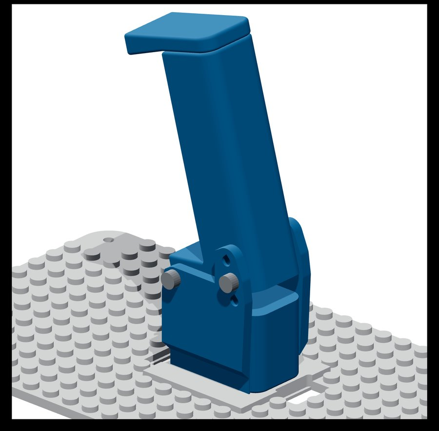
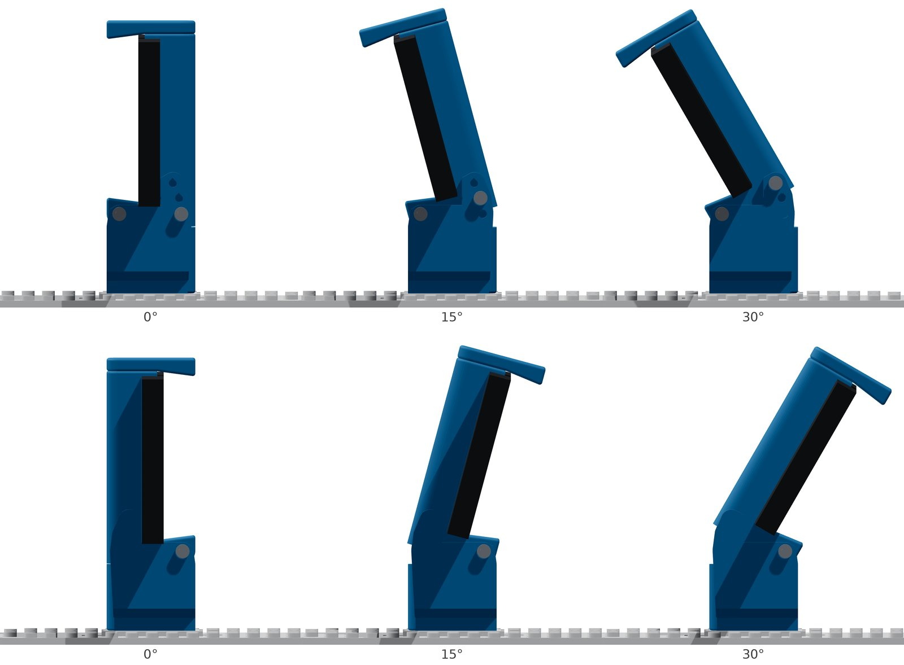

# Handyhalterung

  <a href="README.md">English</a> |
  <a href="README.zh-CN.md">简体中文</a> |
  Deutsch |
  <a href="README.fr-FR.md">Français</a> |
  <a href="README.es-ES.md">Español</a> |
  <a href="README.ko-KR.md">한국어</a>

Die zweiteilige Handyhalterung der Bodys [DIY](../diy/README.de-DE.md), [RC truck](../rc_truck/README.de-DE.md) und [Compact](../compact/README.de-DE.md). Ein verschiebbarer Griff drückt das Handy gegen eine Auflage und wird von einem Gummiband oder einer leichten Feder gespannt. Eine optionale neigbare Version hält das Handy bei 0°, 15° oder 30°, sodass die Kamera nach oben schauen kann, etwa auf eine Person vor dem Roboter. Um 180° gedreht montiert, schaut die Kamera stattdessen nach unten.

## Teile

| Teil | Anzahl | Hinweise |
|---|---:|---|
| `phone_mount_bottom` ([STL](phone_mount_bottom.stl), [STEP](phone_mount_bottom.step)) | 1 | Basis und Säule; wird mit zwei M3 × 25 mm Schrauben und Muttern am Body befestigt |
| `phone_mount_top` ([STL](phone_mount_top.stl), [STEP](phone_mount_top.step)) | 1 | Verschiebbarer Griff; passt zu beiden Basen |
| `phone_mount_tilt_base` ([STL](phone_mount_tilt_base.stl), [STEP](phone_mount_tilt_base.step)) | 1 *(optional)* | Neigbare Halterung: Fuß mit zwei Scharnierwangen; ersetzt `phone_mount_bottom` |
| `phone_mount_tilt_column` ([STL](phone_mount_tilt_column.stl), [STEP](phone_mount_tilt_column.step)) | 1 *(optional)* | Neigbare Halterung: Säule, die sich zwischen den Wangen dreht |

## Drucken

Die Dateien liegen bereits in Druckausrichtung: Drucken Sie jedes Teil so, wie es ist, aufrecht stehend. PLA mit 0,2 mm Schichthöhe, 4 Wänden und 30 % Füllung funktioniert gut. `phone_mount_tilt_base` braucht keine Stützen. `phone_mount_bottom`, `phone_mount_top` und `phone_mount_tilt_column` brauchen Stützen nur unter dem Rand des Zapfens für das Gummiband; Baumstützen mit ausgeschaltetem „Kleine Überhänge entfernen“ ergeben dort einen kleinen Baum, den Sie durch die offene Rückseite des Kanals herausziehen. Der Rand läuft ganz um den Zapfen, sodass das Gummiband auch locker nicht abrutscht.

## Neigbare Handyhalterung

  
  

Die neigbare Basis nutzt dieselben zwei Befestigungslöcher wie die normale Basis und passt in dieselben Vertiefungen: die DIY-Deckplatte, den RC-truck-Rahmen und den Kamera-Erhöher sowie den Compact-Deckel. Ihre Wangen beginnen 5 mm über der Unterseite des Fußes und berühren daher den Rand dieser Vertiefungen nicht. Das Handy sitzt 10,5 mm höher als auf der normalen Halterung. Bei 30° bewegt sich das obere Ende der Säule etwa 22 mm nach hinten (gedreht montiert nach vorne); prüfen Sie, dass auf Ihrem Body nichts im Weg ist. Sie können die Basis auch um 180° gedreht anschrauben. Die Säule neigt sich dann nach vorne: Setzen Sie das Handy mit dem Bildschirm zur Säule ein, dann schaut die Kamera nach vorne und unten.

Zusätzlich zu den Befestigungsschrauben brauchen Sie drei M3 × 10 mm Flachkopfschrauben und fünf M3-Gewindeeinsätze (4,6 mm Außendurchmesser, 5,7 mm lang). Die Messinggewinde halten auch bei häufigem Verstellen.

1. Schmelzen Sie drei M3-Gewindeeinsätze (4,6 mm Außendurchmesser, 5,7 mm lang) in die Säule ein: je einen in beide Enden des hinteren Drehlochs und einen in das vordere Arretierloch, das nur auf einer Seite offen ist.
2. Schmelzen Sie zwei M3-Einsätze in die Löcher an der Unterseite des Fußes ein. Schrauben Sie den Fuß durch dieselben zwei Befestigungslöcher wie die normale Basis von unten an den Body, mit Schrauben, die etwa 5 mm in den Fuß reichen (M3 × 10 mm durch den 5 mm dicken Compact-Deckel).
3. Setzen Sie die Säule so zwischen die Wangen, dass das offene Arretierloch zur Wange mit vier Löchern zeigt. Drehen Sie durch jede Wange eine M3 × 10 mm Schraube in die Einsätze des Drehlochs und ziehen Sie sie an, bis sich die Säule ohne Spiel drehen lässt. Geben Sie auf beide Achsschrauben einen Tropfen mittelfeste (blaue) Schraubensicherung, damit sie sich nicht lösen.
4. Neigen Sie die Säule, bis ihr Arretiereinsatz mit einem der drei Löcher der Wange fluchtet: Das unterste ergibt 0°, das mittlere 15° und das oberste 30°. Arretieren Sie die Säule mit der dritten M3 × 10 mm Schraube.
5. Setzen Sie `phone_mount_top` und das Gummiband wie bei der normalen Halterung ein.
