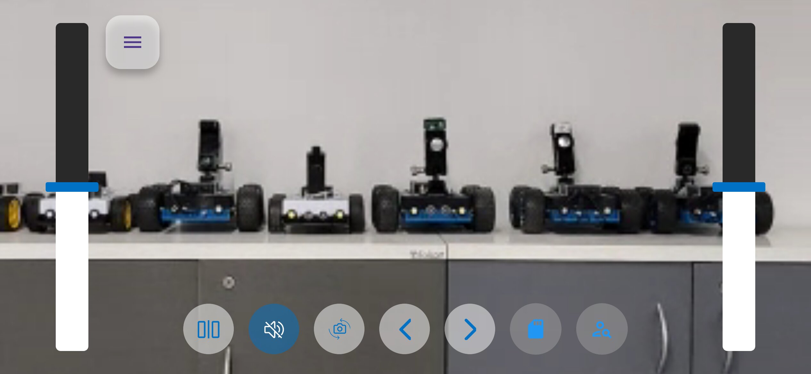
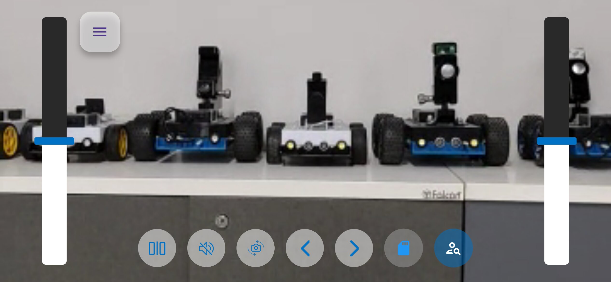
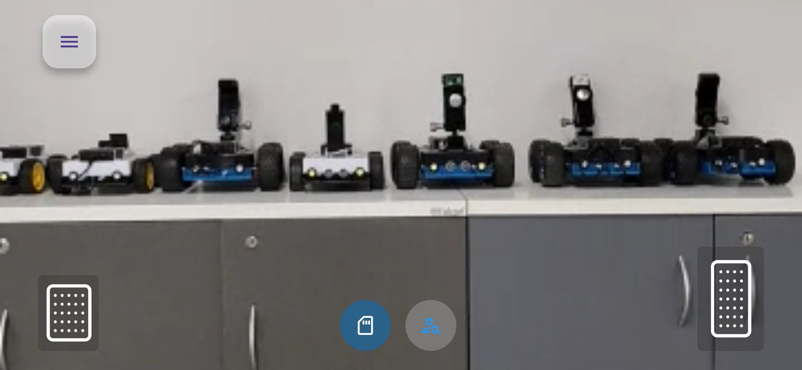
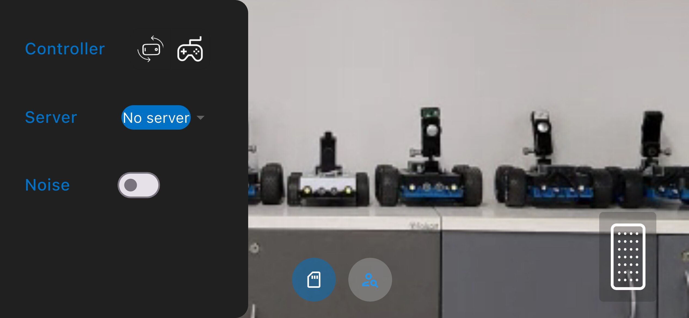

# Flutter 컨트롤러 앱

<p align="center">
  <a href="README.md">English</a> |
  <a href="README.zh-CN.md">简体中文</a> |
  <a href="README.de-DE.md">Deutsch</a> |
  <a href="README.fr-FR.md">Français</a> |
  <a href="README.es-ES.md">Español</a> |
  <span>한국어</span>
</p>

이 컨트롤러 앱은 [OpenBot](https://www.openbot.org) 차량의 `리모컨` 역할을 합니다. PS3/4나 Xbox와 같은 Bluetooth 컨트롤러와 유사한 기능을 제공하며, 또 다른 Android/iOS 기기에서 실행됩니다. 이 앱은 제어 기능 외에도 실시간 비디오/오디오 스트리밍을 지원합니다.

## 앱 설치하기

Android에서는 최신 [릴리스](https://github.com/ob-f/OpenBot/releases)의 에셋에서 `Controller-<version>.apk`를 다운로드하여 휴대폰에 [설치](https://www.lifewire.com/install-apk-on-android-4177185)하세요.

> **기존 사용자 참고:** 이 앱은 각 릴리스와 함께 배포되는 컨트롤러 APK로서 기존 Android 컨트롤러 앱을 대체합니다. 두 앱은 서로 다른 패키지 ID(`org.openbot.app.controller`와 `org.openbot.controller`)를 사용하므로, 이 APK를 설치해도 기존 앱이 업데이트되지 않고 별도의 앱으로 함께 설치됩니다. 새 앱으로 전환한 후에는 기존 컨트롤러를 삭제해도 됩니다.

## 시작하기
먼저 시스템에 [Flutter](https://flutter.dev/)를 설치하세요. 운영 체제에 맞는 다운로드 옵션을 선택하고, Windows, macOS, Linux, ChromeOS를 포함한 모든 플랫폼에 대한 설치 방법은 공식 Flutter 설치 가이드에서 확인할 수 있습니다: [Flutter 설치 가이드](https://docs.flutter.dev/get-started/install)

### 터미널 사용하기
- Flutter가 성공적으로 설치되면 **터미널** 또는 **명령 프롬프트**를 엽니다.
- OpenBot 프로젝트가 저장된 위치로 이동한 후, `OpenBot/controller/flutter` 폴더로 이동합니다.
- 터미널에서 Flutter 애플리케이션을 실행하려면 아래 명령어를 사용하세요.

  #### 의존성 설치:
    ```bash
     flutter pub get 
    ```
  프로젝트 실행:
    ```bash
     flutter run
    ```
  문제가 발생하면 다음 명령어를 실행해보세요:
    ```bash
     flutter doctor
    ```

### 에디터 사용하기
- Flutter 에디터 설정을 위한 공식 가이드를 따르세요: [에디터 설정하기](https://docs.flutter.dev/tools/android-studio)
- 에디터가 Flutter 개발을 위한 설정이 되어 있는지 확인하세요. 필요한 플러그인이나 확장 프로그램을 설치하고, 에디터에 맞는 Flutter 문서를 참조하여 최상의 개발 환경을 설정합니다.

- 에디터에서 프로젝트를 열면 아래와 같은 화면이 나타납니다.

  <p float="left">
    
  </p>

- 위에서 설명한 터미널 명령어를 참고하여, 향후 반복 실행을 위해서는 에디터에서 ``run`` 버튼을 직접 눌러 실행할 수 있습니다.

  <p float="left">
    
  </p>

## 서명된 릴리스 빌드 만들기(Android)
릴리스 빌드(`flutter build apk --release` / `flutter build appbundle --release`)는 `android/key.properties`에서 참조하는 키 저장소로 서명됩니다. 이 파일은 **gitignore**되어 커밋되지 않으므로 개발자마다 자신의 로컬 사본을 만들어야 합니다. 디버그 빌드(`flutter build apk --debug`, `flutter run`)에는 필요하지 않습니다.

### 1. 키 저장소 생성(한 번만)
```bash
keytool -genkey -v -keystore ~/release.keystore -alias upload -keyalg RSA -keysize 2048 -validity 10000
```
생성한 `.keystore`/`.jks` 파일과 비밀번호는 저장소 밖 안전한 곳에 보관하세요. 잃어버리면 같은 앱 서명으로 더 이상 업데이트를 배포할 수 없습니다.

### 2. `android/key.properties` 만들기
`android/app/build.gradle`은 `controller/flutter/android/key.properties`에서 이 파일을 읽으므로, 그 위치에 다음 내용으로 만드세요.
```properties
storePassword=<your keystore password>
keyPassword=<your key password>
keyAlias=upload
storeFile=/absolute/path/to/release.keystore
```
`storeFile`은 1단계에서 생성한 키 저장소의 절대 경로(또는 `controller/flutter/android/app/`에서 찾을 수 있는 경로)여야 합니다.

### 3. 빌드
```bash
cd controller/flutter
flutter build appbundle --release   # Play 스토어 업로드용(.aab)
# 또는
flutter build apk --release         # 서명된 설치용 APK
```
`app/build.gradle`은 `key.properties`가 있으면 자동으로 불러와 `release` 서명 구성에 사용합니다. 파일이 없으면 릴리스 구성에 서명 값이 없어 서명에 실패합니다(디버그 빌드는 영향을 받지 않습니다).

## 연결

컨트롤러 휴대폰과 로봇 휴대폰은 같은 Wi-Fi 네트워크에 연결되어 있거나, 한 휴대폰이 다른 휴대폰의 핫스팟에 연결되어 있어야 합니다. 인터넷 연결은 필요하지 않습니다.

컨트롤러 앱이 시작되면, 즉시 로봇에 연결을 시도하고 다음과 같은 화면을 표시합니다:

<p float="left">
  
</p>

컨트롤러를 로봇에 연결하려면, 로봇의 제어 모드를 **Phone**으로 설정해야 합니다. 예를 들어, `FreeRoamFragment`에서 전화 모드는 다음과 같이 활성화됩니다:

<p float="left">
  
</p>

연결이 완료되면 컨트롤러 앱은 다음과 같이 표시됩니다:

<p float="left">
  
</p>

여기서 전화 기울기를 사용하여 로봇을 조종하거나 화면상의 컨트롤을 사용하여 로봇을 조종할 수 있습니다.

***참고:*** 이 방법으로 연결할 수 있어야 하지만, 30초 이내에 연결이 되지 않으면, 봇 앱에서 `Control` 설정을 `Gamepad`로 변경한 뒤 다시 `Phone`으로 설정하여 연결을 재시도해 보세요. 그래도 연결되지 않으면, 컨트롤러 앱을 종료하고 다시 시작한 후, 로봇 앱에서 제어 모드를 다시 전환해 보세요.

## 작동

### 화면 컨트롤

이 모드는 사용자가 `Dual Drive` 모드에서 두 개의 슬라이더를 통해 로봇 자동차를 제어할 수 있게 해줍니다. 각 슬라이더에서 엄지손가락을 위/아래로 움직여 왼쪽/오른쪽으로 회전할 수 있습니다. 슬라이더의 중앙 위/아래로 엄지손가락을 이동하면 각각 왼쪽/오른쪽 바퀴가 앞으로/뒤로 회전합니다.

<p float="left">
  
</p>

- ``Indicators``: 화면 왼쪽 상단의 화살표  를 클릭하여 좌/우 회전 지시등을 설정할 수 있습니다.

- ``Switch Camera``: 전방과 후방 카메라 모드를 전환합니다.
- ``Mute``: 오디오 전송을 활성화/비활성화합니다.
- ``Mirror view``: 비디오 피드를 미러링합니다.

### 기울여서 운전

컨트롤러는 또한 가속도계 모션 센서를 사용하여 로봇을 운전할 수 있습니다. 이 옵션을 선택하면 컨트롤러는 전체 화면(Zen) 모드로 전환되어 비디오만 표시되고 `브레이크`와 `엑셀러레이터` 페달만 표시됩니다. 이 모드를 종료하려면 화면을 더블탭하세요.

`기울여서 운전` 모드 화면은 다음과 같습니다:

<p float="left">
  
</p>

`엑셀러레이터`와 `브레이크` 버튼을 사용하여 전진/후진합니다.

- `엑셀러레이터`를 누르면 로봇은 2초 이내에 최대 속도로 가속됩니다. 버튼을 떼면 로봇은 속도를 줄여 정지합니다(정지 속도는 최대 속도의 0%로 설정 가능).
- `브레이크` 버튼을 누르면 로봇이 즉시 정지합니다. 브레이크를 1초 더 누르면 로봇이 후진을 시작하고 1초 이내에 최대 후진 속도에 도달합니다. 브레이크를 떼면 로봇은 정지합니다.
- 로봇은 컨트롤러 폰을 왼쪽/오른쪽으로 기울여 조종합니다.

### 컨트롤러 설정 UI

`Controller Settings` 화면의 모습입니다.

- 컨트롤러 선택: 아이콘으로 여러 컨트롤러 유형(예: 휴대폰, 조이스틱)을 전환합니다.
 
- 서버: 현재 서버 상태를 보여 주며, 드롭다운으로 서버를 선택하거나 바꿀 수 있습니다.
 
- 노이즈 토글: 스위치로 노이즈 시뮬레이션을 켜거나 끕니다.

<p float="left">
  
</p>

여기에는 [기술 개요](../../docs/technical/OpenBotController.pdf)도 포함되어 있습니다.
