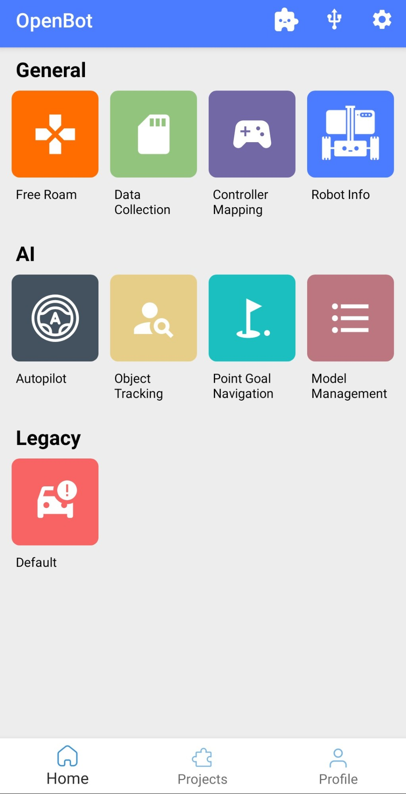
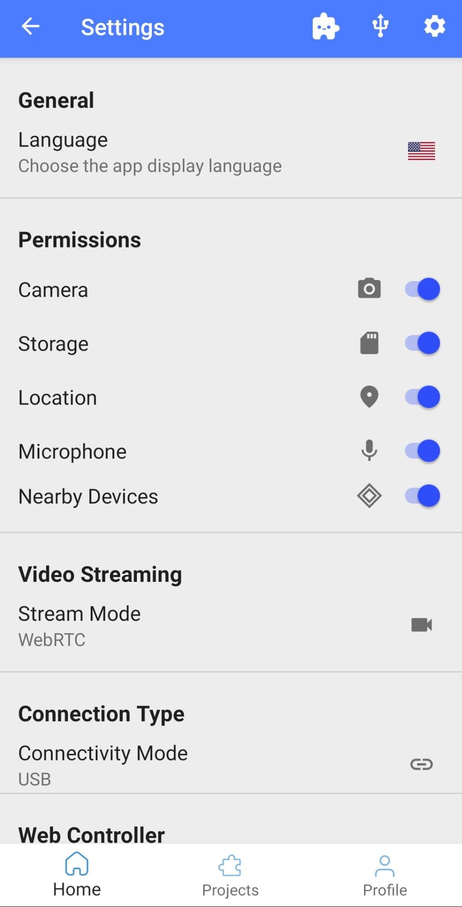
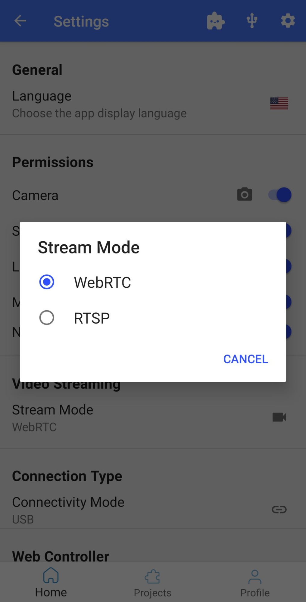
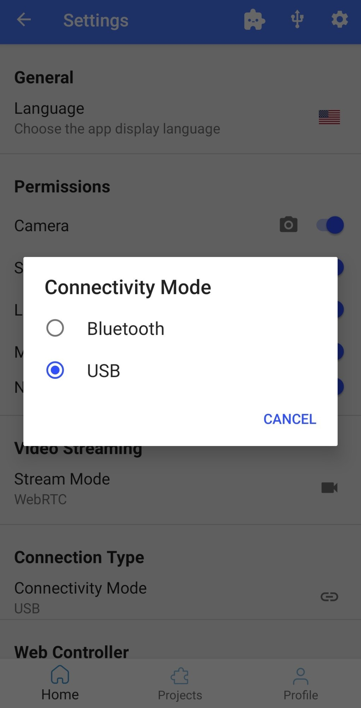
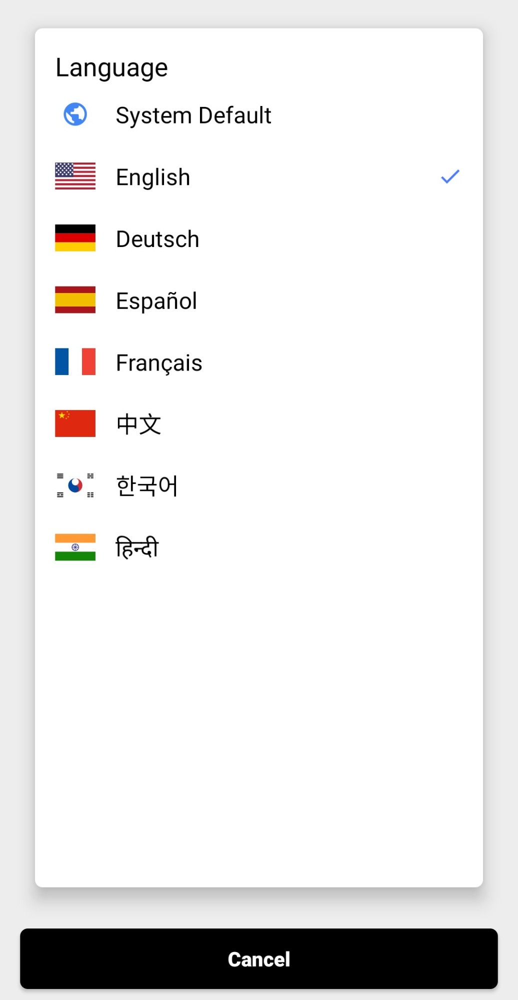
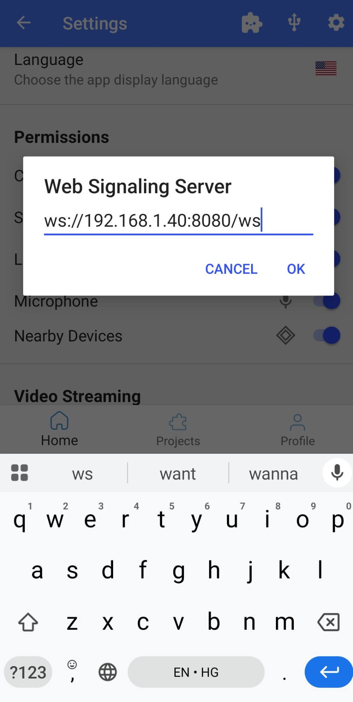

# Robot App

  <a href="README.md">English</a> |
  <a href="README.zh-CN.md">简体中文</a> |
  <a href="README.de-DE.md">Deutsch</a> |
  <a href="README.fr-FR.md">Français</a> |
  Español |
  <a href="README.ko-KR.md">한국어</a>

## AVISOS

1. **Seguridad:** Asegúrate siempre de operar en un entorno seguro. Ten en cuenta que tu teléfono podría dañarse en una colisión. Se requiere un cuidado especial al usar el control automatizado (por ejemplo, seguimiento de personas o política de conducción). Asegúrate de tener siempre un controlador de juegos conectado y estar familiarizado con la asignación de teclas para poder detener el vehículo en cualquier momento. ¡Usa bajo tu propio riesgo!
2. **Aplicación en desarrollo:** La aplicación está en desarrollo y puede fallar o mostrar un comportamiento inesperado dependiendo del modelo de tu teléfono y la versión del sistema operativo. Asegúrate de probar todas las funcionalidades sin las ruedas conectadas. ¡Usa bajo tu propio riesgo!

## Pantallas de la Aplicación

### Menú Principal

La aplicación comienza con una pantalla de menú que muestra todas las pantallas disponibles. La pantalla de configuración se puede abrir con un clic en el ícono en la esquina superior derecha. Al hacer clic en los otros íconos, el usuario puede acceder a varias pantallas cuyas funcionalidades se explican a continuación.

### Menú de Configuración

#### Soporte multilingüe

Toca `Idioma` en la categoría General para elegir el idioma de la app. Selecciona `Predeterminado del sistema` para usar el idioma de tu teléfono, o elige uno de los idiomas disponibles: English, Deutsch, Español, Français, 中文, 한국어 o हिन्दी. La app aplica el nuevo idioma al instante.

#### Servidor de señalización web

Toca `Servidor de señalización web` en la categoría Controlador web para introducir la dirección WebSocket del servidor de señalización, por ejemplo `ws://<ip-del-servidor>:8080/ws`. Se usa cuando el modo de control es servidor web, por lo que el teléfono y el servidor deben estar en la misma red Wi-Fi. Consulta el [servidor web](../../../controller/web-server/README.md) para ver cómo configurarlo.

#### Conexión USB

Toca el ícono USB para abrir las opciones USB. El menú desplegable se usa para configurar la velocidad en baudios. El valor predeterminado es 115200 y no deberías necesitar cambiarlo a menos que modifiques el firmware de Arduino. La aplicación intentará conectarse automáticamente, pero en caso de que encuentres problemas, puedes usar este interruptor para desconectar/conectar.

#### Permisos

Aquí puedes verificar los permisos de la aplicación y ajustarlos si es necesario.

#### Transmisión de Video

Puedes elegir entre `WebRTC` y `RTSP` para transmitir video a un dispositivo externo. La aplicación controladora del teléfono y el servidor node-js necesitan que esto esté configurado en `WebRTC`. El controlador de Python espera que la transmisión esté configurada en `RTSP`.

#### Conexión Bluetooth

Asegúrate de que tu dispositivo Android tenga soporte BLE (Bluetooth Low Energy). Si tu versión de Android es mayor o igual a 7.0, también necesitas activar el servicio de ubicación y permitir el permiso de ubicación en la configuración para buscar dispositivos BLE cercanos. Para habilitar BLE, cambia el modo de conectividad de USB a Bluetooth en el menú de configuración. Obtendrás un ícono de Bluetooth en la parte superior de la pantalla de inicio. Toca el ícono de Bluetooth para iniciar el escaneo BLE; toma 4 segundos escanear y obtener una lista de todos los dispositivos OpenBot BLE cercanos. Conéctate con tu OpenBot tocando el botón `Conectar`. Después de una conexión exitosa, el botón `Conectar` cambiará a `Desconectar`. Ahora puedes volver a la pantalla de inicio.

### Exploración Libre

Exploración Libre ofrece un control simple del robot con actualizaciones en tiempo real e información sobre la batería, velocidad y distancia de las superficies.

- **Batería**: El ícono de la batería muestra los niveles de batería en tiempo real del robot conectado.
- **Estado de Conducción**: Hay 3 estados de conducción mostrados en la vista:
  - D -> Conducción, cuando el robot está avanzando
  - N -> Neutro, cuando el robot está estacionario
  - R -> Reversa, cuando el robot está retrocediendo
  El volante gira proporcionalmente al ángulo de dirección.
- **Velocidad**: El velocímetro muestra la velocidad del robot.
- **Sonar**: La distancia libre frente al robot en cm.
- **Control**: Controlador, Modo de Conducción y Velocidad se usan para controlar la configuración del robot como se describe en la [sección de control](#control).

### Recolección de Datos

Interfaz simple para la recolección de conjuntos de datos.

- **Servidor**: Si tienes la [aplicación web](../../../policy/README.md#web-app) para el entrenamiento de políticas en funcionamiento, puedes seleccionarla aquí para cargar datos automáticamente.
- **Resolución de Vista Previa**: Se usa para cambiar entre resoluciones de vista previa de la cámara. Hay 3 configuraciones:
  - ***FULL_HD*** (1920x1080p)
  - ***HD*** (1280x720p)
  - ***SD*** (640x360)
- **Resolución del Modelo**: Se usa para cambiar entre resoluciones de imágenes guardadas para entrenar diferentes modelos.
- **Guardar/Descartar los Datos Recogidos**: el proceso de recolección de datos se puede controlar desde la pantalla o de forma remota, por ejemplo, desde un controlador Bluetooth. Al usar un controlador Bluetooth, puedes:
  - Presionar el **botón A** para **iniciar** el proceso de recolección de datos
  - Presionar el **botón A nuevamente** para **detener** la recolección de datos y guardar los datos recogidos en un archivo .zip
  - Alternativamente, presionar el **botón R1** para **detener** la recolección de datos **sin guardar** los datos recogidos (por ejemplo, debido a una colisión inesperada con el entorno)
  - Recuerda usar el fragmento de asignación de controladores para asegurarte de estar usando los botones correctos.

### Asignación de Controladores

Interfaz simple para verificar la asignación de botones y joysticks de un controlador BT conectado.

### Información del Robot

Interfaz simple para obtener información del robot y probar la funcionalidad básica. El **Tipo de Robot** configurado en el firmware se muestra como texto y animación. Las marcas de verificación en las secciones **Sensores**, **Odómetro de Ruedas** y **LEDs** muestran qué características son compatibles con el robot conectado. La sección **Lecturas** proporciona las mediciones de sensores más importantes. En la sección **Enviar Comandos**, los usuarios pueden enviar comandos básicos de motor presionando los botones correspondientes y controlar los LEDs delanteros y traseros con un deslizador.

### Piloto Automático

Interfaz simple para ejecutar modelos de piloto automático.

- **Servidor**: Si tienes la [aplicación web](../../../policy/README.md#web-app) para el entrenamiento de políticas en funcionamiento, puedes seleccionarla aquí y enviar modelos de piloto automático entrenados al robot.
- **Modelo**: Elige un modelo entrenado para usar en el modo de piloto automático.
- **Dispositivo**: Usa CPU, GPU o NNAPI para la inferencia (más detalles [aquí](#dispositivo)).
- **Hilos**: Número de hilos a usar (solo hace una diferencia cuando se selecciona CPU como dispositivo).
- **Control**: Controlador, Modo de Conducción y Velocidad se usan para controlar la configuración del robot como se describe en la [sección de control](#control).

### Seguimiento de Objetos

Interfaz simple para el seguimiento de objetos de 80 clases diferentes. Una breve descripción de los diferentes modelos de IA para el seguimiento de objetos y los puntos de referencia de rendimiento se pueden encontrar en [Gestión de Modelos](#gestión-de-modelos).

- **Velocidad Dinámica**: reduce la velocidad del robot en "Modo Automático" si se acerca al objeto rastreado.
  La velocidad se escala en función del área del cuadro delimitador (funciona mejor en orientación horizontal).
- **Modelo**: Elige un detector de objetos basado en el rendimiento de tu teléfono (ver más abajo para [resultados de referencia](#punto-de-referencia)).
- **Objeto**: Elige el objeto que deseas rastrear. Los modelos pueden detectar las 80 [clases de objetos COCO](https://tech.amikelive.com/node-718/what-object-categories-labels-are-in-coco-dataset/).
- **Confianza**: Umbral de confianza para determinar si se aceptan las detecciones. Aumenta si obtienes detecciones falsas, disminuye si el objeto de interés no se detecta.
- **Dispositivo**: Usa CPU, GPU o NNAPI para la inferencia (más detalles [aquí](#dispositivo)).
- **Hilos**: Número de hilos a usar (solo hace una diferencia cuando se selecciona CPU como dispositivo).
- **Control**: Controlador, Modo de Conducción y Velocidad se usan para controlar la configuración del robot como se describe en la [sección de control](#control).

### Navegación a Punto de Destino

Ten en cuenta que este fragmento requiere ARCore y permiso de cámara. Si tu dispositivo no es compatible con ARCore y continúas de todos modos, la aplicación se bloqueará. En esta pantalla puedes especificar un objetivo a través de un vector 2D con respecto a la posición y orientación actual del robot. El vector 2D contiene la distancia al frente y a la izquierda del robot en metros. Ambos valores también pueden ser negativos y corresponder a la parte trasera y derecha del robot en ese caso. Después de especificar el objetivo y presionar `Iniciar`, el robot ejecutará una política de IA que intentará alcanzar el objetivo mientras evita obstáculos.

### Gestión de Modelos

Todos los modelos están cuantizados para un mejor rendimiento en dispositivos integrados. Consulta la sección a continuación para una breve descripción de los modelos disponibles y los resultados de referencia. La [precisión media promedio (mAP)](https://kharshit.github.io/blog/2019/09/20/evaluation-metrics-for-object-detection-and-segmentation) se calcula en el conjunto de validación del conjunto de datos [COCO Detection 2017](https://cocodataset.org/#detection-2017). Cada modelo se ejecuta durante aproximadamente 1 minuto; el tiempo de inferencia se promedia en los últimos 100 fotogramas y se informa en fotogramas por segundo (fps). Ten en cuenta que los modelos con mayor resolución de entrada pueden ser mejores para objetos más pequeños a pesar de un mAP más bajo.

### Punto de Referencia

#### Teléfonos

| Nombre del Modelo | Chipset        | RAM  | SO |
|-------------------|----------------|------|----|
| Samsung S22 Ultra | Exynos 2200    | 12GB | 12 |
| Samsung S20FE 5G  | Snapdragon 865 |  6GB | 12 |
| Huawei P30 Pro    | Kirin 980      |  8GB | 10 |
| Google Pixel 6XL  | Google Tensor  | 12GB | 12 |
| Xiaomi Mi9        | Snapdragon 855 |  6GB | 10 |
| Google Pixel 4XL  | Snapdragon 855 |  6GB | 13 |

#### MobileNetV1-300 (preinstalado) - mAP: 18%

Detector de objetos SSD con [MobileNet V1](https://tfhub.dev/tensorflow/lite-model/ssd_mobilenet_v1/1/metadata/2) como backbone y resolución de entrada de 300x300.

|teléfono/dispositivo (fps)| CPU | GPU | NNAPI |
|--------------------------|-----|-----|-------|
| Samsung S22 Ultra        |  33 |  13 |   30  |
| Samsung S20FE 5G         |  34 |  57 |   87  |
| Huawei P30 Pro           |  36 |  25 |   10  |
| Google Pixel 6XL         |  35 |  42 |   53  |
| Xiaomi Mi9               |  22 |  41 |   33  |
| Google Pixel 4XL         |  37 |  36 |   45  |

#### MobileNetV3-320 - mAP: 16%

Detector de objetos SSD con MobileNet V3 como backbone y resolución de entrada de 320x320.

|teléfono/dispositivo (fps)| CPU | GPU | NNAPI |
|--------------------------|-----|-----|-------|
| Samsung S22 Ultra        |  30 |  17 |   30  |
| Samsung S20FE 5G         |  34 |  42 |   28  |
| Huawei P30 Pro           |  32 |  27 |   23  |
| Google Pixel 6XL         |  33 |  43 |   27  |
| Xiaomi Mi9               |  20 |  45 |   10  |
| Google Pixel 4XL         |  32 |  38 |   21  |

#### YoloV4-tiny-224 - mAP: 22%

Versión pequeña de [YoloV4](https://arxiv.org/abs/2004.10934) con resolución de entrada de 224x224.

|teléfono/dispositivo (fps)| CPU | GPU | NNAPI |
|--------------------------|-----|-----|-------|
| Samsung S22 Ultra        |  31 |  12 |   31  |
| Samsung S20FE 5G         |  30 |  21 |   14  |
| Huawei P30 Pro           |  27 |  17 |   22  |
| Google Pixel 6XL         |  29 |  24 |   19  |
| Xiaomi Mi9               |  16 |  14 |  9.3  |
| Google Pixel 4XL         |  22 |  19 |   14  |

#### YoloV4-tiny-416 - mAP: 29%

Versión pequeña de [YoloV4](https://arxiv.org/abs/2004.10934) con resolución de entrada de 416x416.

|teléfono/dispositivo (fps)| CPU | GPU | NNAPI |
|--------------------------|-----|-----|-------|
| Samsung S22 Ultra        |  13 | 9.8 |   13  |
| Samsung S20FE 5G         |  12 | 9.4 |  7.7  |
| Huawei P30 Pro           | 8.4 | 7.6 |  6.9  |
| Google Pixel 6XL         |  10 | 9.6 |  7.2  |
| Xiaomi Mi9               | 9.0 | 7.3 |  5.0  |
| Google Pixel 4XL         | 7.2 | 7.4 |  6.2  |

#### YoloV4-224 - mAP: 40%

[YoloV4](https://arxiv.org/abs/2004.10934) con resolución de entrada de 224x224.

|teléfono/dispositivo (fps)| CPU | GPU | NNAPI |
|--------------------------|-----|-----|-------|
| Samsung S22 Ultra        | 3.7 | 5.6 |  3.5  |
| Samsung S20FE 5G         | 3.1 | 7.1 |  4.2  |
| Huawei P30 Pro           | 2.4 | 6.2 |  0.7  |
| Google Pixel 6XL         | 2.7 |  11 |  0.9  |
| Xiaomi Mi9               | 2.1 | 6.4 |  1.7  |
| Google Pixel 4XL         | 1.8 | 5.0 |  3.7  |

#### YoloV5s-320 - mAP: 28%

[YoloV5](https://github.com/ultralytics/yolov5) con resolución de entrada de 320x320.

|teléfono/dispositivo (fps)| CPU | GPU | NNAPI |
|--------------------------|-----|-----|-------|
| Samsung S22 Ultra        |  21 |  10 |   21  |
| Xiaomi Mi9               |  13 |  15 |  0.8  |
| Google Pixel 4XL         |  12 |  17 |   18  |

#### YoloV5s-640 - mAP: 34%

[YoloV5](https://github.com/ultralytics/yolov5) con resolución de entrada de 640x640.

|teléfono/dispositivo (fps)| CPU | GPU | NNAPI |
|------------------|-----|-----|-------|
| Samsung S22 Ultra| 5.5 | 4.9 |  5.0  |
| Xiaomi Mi9       | 4.1 | 4.6 |   -   |
| Google Pixel 4XL | 3.7 | 4.6 |  4.6  |

#### YoloV5m-320 - mAP: 35%

[YoloV5](https://github.com/ultralytics/yolov5) con resolución de entrada de 320x320.

|teléfono/dispositivo (fps)| CPU | GPU | NNAPI |
|------------------|-----|-----|-------|
| Samsung S22 Ultra|  13 | 8.2 |   11  |
| Xiaomi Mi9       | 9.7 | 9.9 |   -   |
| Google Pixel 4XL | 7.9 | 9.2 |   15  |

#### YoloV5l-320 - mAP: 38%

[YoloV5](https://github.com/ultralytics/yolov5) con resolución de entrada de 320x320.

|teléfono/dispositivo (fps)| CPU | GPU | NNAPI |
|------------------|-----|-----|-------|
| Samsung S22 Ultra| 7.6 | 3.4 |  7.6  |
| Xiaomi Mi9       | 5.5 | 5.0 |   -   |
| Google Pixel 4XL | 5.3 | 4.0 |  5.3  |

#### EfficientDet-L0-320 - mAP: 26%

[EfficientDet-L0](https://tfhub.dev/tensorflow/lite-model/efficientdet/lite0/detection/metadata/1) con resolución de entrada de 320x320. Nota: el rendimiento del modelo empeora en modo horizontal; puede que haya que ajustar el umbral de confianza.

|teléfono/dispositivo (fps)| CPU | GPU | NNAPI |
|------------------|-----|-----|-------|
| Samsung S22 Ultra|  18 |  10 |   16  |
| Xiaomi Mi9       |  16 |  20 |  1.2  |
| Google Pixel 4XL |  17 |  17 |   16  |

#### EfficientDet-L1-384 - mAP: 31%

[EfficientDet-L1](https://tfhub.dev/tensorflow/lite-model/efficientdet/lite1/detection/metadata/1) con resolución de entrada de 384x384. Nota: el rendimiento del modelo empeora en modo horizontal; puede que haya que ajustar el umbral de confianza.

|teléfono/dispositivo (fps)| CPU | GPU | NNAPI |
|------------------|-----|-----|-------|
| Samsung S22 Ultra|  12 | 9.2 |   10  |
| Xiaomi Mi9       |  10 |  13 |    -  |
| Google Pixel 4XL |  11 |  11 |   10  |

#### EfficientDet-L2-448 - mAP: 34%

[EfficientDet-L2](https://tfhub.dev/tensorflow/lite-model/efficientdet/lite2/detection/metadata/1) con resolución de entrada de 448x448. Nota: el rendimiento del modelo empeora en modo horizontal; puede que haya que ajustar el umbral de confianza.

|teléfono/dispositivo (fps)| CPU | GPU | NNAPI |
|------------------|-----|-----|-------|
| Samsung S22 Ultra| 9.8 | 8.4 |  8.2  |
| Xiaomi Mi9       | 6.4 | 9.4 |   -   |
| Google Pixel 4XL | 7.7 | 8.3 |  7.6  |

### Predeterminado

La [DefaultActivity](src/main/java/org/openbot/app/robot/original/DefaultActivity.java) reúne las funciones más importantes de la aplicación OpenBot en una sola pantalla. Muestra el estado de la conexión con el vehículo y las mediciones de sus sensores. El robot se puede controlar con mandos de juego BT estándar o con otro smartphone que tenga la [aplicación de control](../../../controller/flutter/README.es-ES.md) de OpenBot. También hemos implementado un registrador de datos para recopilar conjuntos de datos con el robot. Actualmente registramos lecturas de los siguientes sensores: cámara, giroscopio, acelerómetro, magnetómetro, sensor de luz ambiental y barómetro. Con la API de Android obtenemos estas lecturas: imágenes RGB, velocidad angular, aceleración lineal, gravedad, intensidad del campo magnético, intensidad de la luz, presión atmosférica, latitud, longitud, altitud, rumbo y velocidad. Además de los sensores del teléfono, registramos las lecturas de los sensores del cuerpo (odometría de las ruedas, distancia a obstáculos y voltaje de la batería), que llegan por la conexión serie. También registramos, con marca de tiempo, las señales de control recibidas de un controlador conectado, si lo hay. Por último, integramos varias redes neuronales para seguir personas y para la navegación autónoma.

  

#### Conexión USB

Igual que en el [menú de ajustes](#settings-menu).

#### Estado del vehículo

El campo **Battery** muestra el voltaje de la batería medido por el Arduino a través del divisor de voltaje. El campo **Speed (l,r)** indica la velocidad de las ruedas (delanteras) izquierda y derecha en rpm. La mide el Arduino con los sensores ópticos de velocidad de las ruedas. El campo **Sonar** muestra el espacio libre delante del coche en centímetros. Lo mide el Arduino con el sensor ultrasónico. Ten en cuenta que solo recibirás valores unos segundos después de establecer la conexión USB.

#### Control

El primer botón sirve para elegir el **modo de control**. Hay dos modos de control:

- **Gamepad**: la aplicación recibe los controles de un mando BT conectado.
- **Phone**: el robot se puede controlar con otro smartphone que tenga instalada la aplicación de control, o con un script de Python en un ordenador conectado a la misma red.

El segundo botón sirve para elegir el **modo de conducción**. Con un mando de juego (p. ej., PS4) hay tres modos de conducción:

- **Game**: usa los gatillos derecho e izquierdo (R2, L2) para acelerar hacia delante y hacia atrás, y cualquiera de los joysticks para girar. Este modo imita el control de los videojuegos de carreras.
- **Joystick**: usa cualquiera de los joysticks para controlar el robot.
- **Dual**: usa los joysticks izquierdo y derecho para controlar los lados izquierdo y derecho del coche. Es dirección diferencial pura.

El tercer botón sirve para elegir el **modo de velocidad**. Hay tres modos de velocidad:

- **Slow**: el voltaje aplicado a los motores se limita al 50 % del voltaje de entrada (~6V).
- **Normal**: el voltaje aplicado a los motores se limita al 75 % del voltaje de entrada (~9V).
- **Fast**: sin límite. Con el acelerador a fondo, los motores reciben todo el voltaje de entrada (~12V). *Es el ajuste predeterminado para ejecutar las redes neuronales.*

Ir más rápido reduce la vida útil de los motores, pero es más divertido. Los controles que se envían al robot se muestran a la derecha. Con el mando de juego, el modo de velocidad sube pulsando el joystick derecho (R3) y baja pulsando el joystick izquierdo (L3).

#### Registro de datos

Hay cuatro modos de registro:

- **only_sensors**: se guardan todos los datos de los sensores, pero ninguna imagen.
- **crop_img**: se guardan todos los datos de los sensores e imágenes recortadas al tamaño de entrada de la red. Es el ajuste predeterminado y el que se debe usar para recopilar datos.
- **preview_img**: se guardan todos los datos de los sensores e imágenes a tamaño completo. Necesita mucha memoria y puede ser lento, pero viene bien para montar vídeos FPV.
- **all_imgs**: se guardan todos los datos de los sensores y las imágenes recortadas y a tamaño completo. Necesita mucha memoria y puede ser lento.

El interruptor de la derecha activa y desactiva el registro. En el mando de juego se puede cambiar con el botón X.

#### Cámara

El primer elemento muestra la resolución de la vista previa. El segundo muestra la resolución del recorte, que es la imagen que se usa como entrada de las redes neuronales. Verás que esta resolución cambia según el modelo que elijas abajo. Si entrenas tu propio piloto automático, elige el modelo `AUTOPILOT_F`. La resolución del recorte debería ser `256x96`. El interruptor de la derecha cambia entre la cámara trasera y la delantera.

#### Modelo

La aplicación incluye dos modelos:

- **MobileNetV1-300**: este modelo se usa para seguir personas. Usa un detector de objetos SSD con base MobileNet V1. El modelo está cuantizado para rendir mejor en dispositivos integrados. Viene con la aplicación.
- **CIL-Mobile**: este modelo se usa para la navegación autónoma. Predice los controles directamente a partir de la imagen de la cámara. Lo más probable es que no funcione en tu entorno. Sigue nuestras instrucciones para entrenar tu propia [política de conducción](../../../policy/README.es-ES.md) y reemplazarlo.

Se pueden descargar más modelos desde la pantalla de gestión de modelos.

El interruptor de la derecha enciende y apaga la red. Mientras la red funciona, genera los controles del robot y el mando de juego queda desactivado. Aun así puedes usar los botones del mando, por ejemplo para cambiar este interruptor con el gatillo R1 y recuperar el control del robot.

#### Dispositivo

Usa el menú desplegable para elegir el dispositivo en el que se ejecuta la red neuronal. Tienes estas opciones:

- **CPU**: la CPU funciona en la mayoría de los teléfonos y es la opción predeterminada. Puedes ajustar el número de hilos para optimizar el rendimiento.
- **GPU**: la mayoría de los smartphones tienen GPU. Las redes con entradas grandes, como imágenes, suelen ir más rápido en la GPU.
- **NNAPI**: usa el [delegado NNAPI de TensorFlow Lite](https://www.tensorflow.org/lite/performance/nnapi). Los smartphones modernos suelen tener aceleradores de IA dedicados. La [Neural Network API](https://developer.android.com/ndk/guides/neuralnetworks) (NNAPI) acelera los modelos de TensorFlow Lite en dispositivos Android con unidad de procesamiento gráfico (GPU), procesador de señal digital (DSP) y unidad de procesamiento neuronal (NPU). ¡Ten en cuenta que en algunos teléfonos antiguos puede ser muy lento!

Si hay un modelo activo, la velocidad de inferencia en [ms] se muestra junto al dispositivo que lo ejecuta.

### Pantalla de proyectos

La pantalla de proyectos muestra tus proyectos de OpenBot Playground si has iniciado sesión con tu cuenta de Google. Puedes ejecutarlos para controlar tu OpenBot o escanear sus códigos QR con el icono del escáner arriba a la derecha. Si no has iniciado sesión, la pantalla muestra un botón para iniciar sesión con Google, pero aun así puedes escanear el código QR de tu proyecto. Si aparece `Oops, no project found` después de iniciar sesión, comprueba que la cuenta tiene proyectos guardados en Google Drive.

Si tus últimos proyectos no aparecen en la lista, desliza la pantalla hacia abajo para recargarlos.

- **Proyectos de Google Drive**: para ejecutar un proyecto de Google Drive, tócalo y espera a que se lea el archivo del proyecto. Si todo va bien, aparece una ventana con el nombre del proyecto y dos botones: `Start` y `Cancel`. Start ejecuta el proyecto y Cancel lo cancela. Si aparece el mensaje `Something went wrong`, probablemente hay un problema con el archivo de Google Drive: recarga la pantalla deslizándola hacia abajo y vuelve a intentarlo.

- **Escáner de códigos QR**: para escanear el código QR de un proyecto de Playground, toca el icono del código QR arriba a la derecha. Permite que la aplicación use la cámara. Después de escanear el código, se lee el archivo. Si todo va bien, aparece una ventana con el nombre del proyecto y dos botones: `Start` y `Cancel`. Start ejecuta el proyecto y Cancel lo cancela. Si aparece el mensaje `Something went wrong`, probablemente hay un problema con el archivo de Google Drive: genera un nuevo código QR en Playground y vuelve a intentarlo.

- **Ejecución del proyecto**: si el proyecto se ejecuta correctamente, la pantalla muestra los nombres de los bloques de código y un botón para detener la ejecución.

- **Borrar un proyecto**: mantén pulsado el proyecto que quieres borrar y confirma con «Yes».

### Pantalla de perfil
La pantalla de perfil ofrece distintas opciones según hayas iniciado sesión o no.
Si no has iniciado sesión, aparece un botón `Google Sign-in` para iniciar sesión con tu cuenta de Google. Una vez dentro, tendrás acceso a tu perfil y a las demás funciones.
Si has iniciado sesión, la pestaña `Profile` muestra dos botones: `Edit Profile` y `Logout`.

- **Edit Profile**: abre una pantalla donde puedes cambiar los datos de tu perfil, como tu nombre y tu foto.

- **Logout**: cierra la sesión de tu cuenta y vuelve a la pantalla de inicio de sesión.

  

  
  
  

### Pantalla de OpenBot PlayGround

Para acceder a los servicios de OpenBot Playground, toca el icono de OpenBot Playground arriba, en la barra de herramientas. Para saber más sobre OpenBot Playground, [haz clic aquí](../../../open-code/README.es-ES.md).

## Añade tu propio fragmento

Consulta la [guía de contribución](ContributionGuide.md) para aprender a añadir tus propios fragmentos a la aplicación OpenBot.

## Estructura del código

La [demo de detección de objetos de TensorFlow Lite para Android](https://github.com/tensorflow/examples/tree/master/lite/examples/object_detection/android) sirvió como punto de partida para integrar los modelos TFLite y obtener la imagen de la cámara. La [DefaultActivity](src/main/java/org/openbot/app/robot/original/DefaultActivity.java) ejecuta el hilo principal y hereda de la [CameraActivity](src/main/java/org/openbot/app/robot/original/CameraActivity.java), que gestiona la cámara y la interfaz. El [SensorService](src/main/java/org/openbot/app/robot/logging/SensorService.java) lee todos los demás sensores del teléfono y los registra. [ServerCommunication](src/main/java/org/openbot/app/robot/server/ServerCommunication.java) y [NsdService](src/main/java/org/openbot/app/robot/server/NsdService.java) establecen la conexión con un [servidor Python](../../../policy/README.es-ES.md#web-app) local con interfaz React. Si recopilas datos, se pueden subir automáticamente para visualizarlos, entrenar modelos de ML y descargar los modelos entrenados al robot. La carpeta [env](src/main/java/org/openbot/app/robot/env) contiene clases de utilidad, como la interfaz [Vehicle](src/main/java/org/openbot/app/robot/vehicle/Vehicle.java), la interfaz [GameController](src/main/java/org/openbot/app/robot/env/GameController.java), la interfaz [PhoneController](src/main/java/org/openbot/app/robot/env/PhoneController.java) y un [AudioPlayer](src/main/java/org/openbot/app/robot/env/AudioPlayer.java) para las indicaciones sonoras. La carpeta [tflite](src/main/java/org/openbot/app/robot/tflite) contiene las definiciones de los modelos de las redes [Autopilot](src/main/java/org/openbot/app/robot/tflite/Autopilot.java) y [Detector](src/main/java/org/openbot/app/robot/tflite/Detector.java).

## Siguiente (opcional)

Entrena tu propia [política de conducción](../../../policy/README.es-ES.md)
