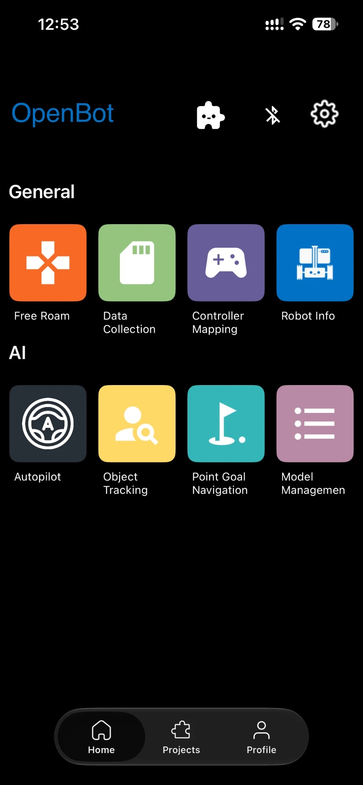
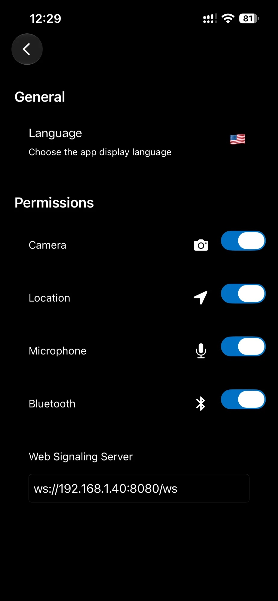
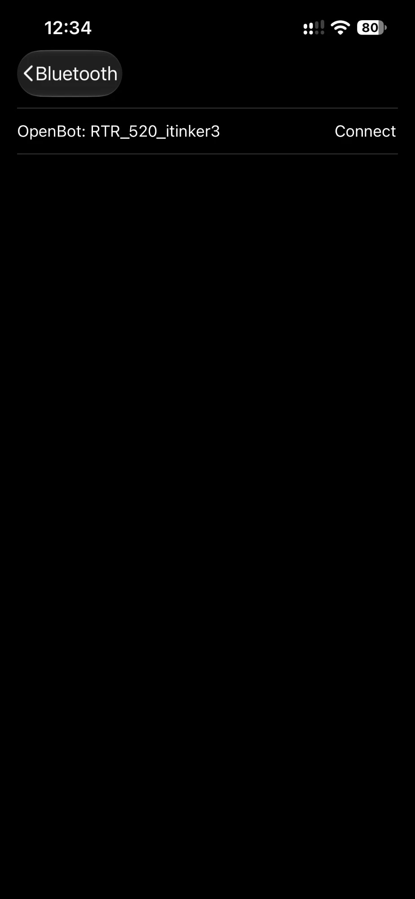
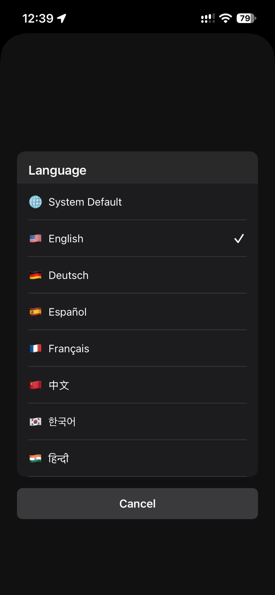
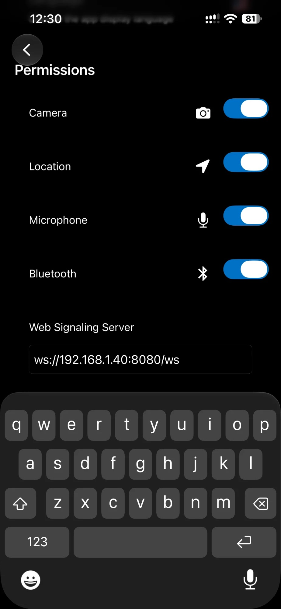

# Robot iOS App - Beta Release

  <a href="README.md">English</a> |
  <a href="README.zh-CN.md">简体中文</a> |
  <a href="README.de-DE.md">Deutsch</a> |
  <a href="README.fr-FR.md">Français</a> |
  Español |
  <a href="README.ko-KR.md">한국어</a>

## DESCARGOS DE RESPONSABILIDAD

1. **Seguridad:** Asegúrate siempre de operar en un entorno seguro. Ten en cuenta que tu teléfono podría dañarse en una colisión. Se requiere un cuidado especial al usar el control automatizado (por ejemplo, seguimiento de personas o política de conducción). Asegúrate de tener siempre un controlador de juego conectado y estar familiarizado con la asignación de teclas para poder detener el vehículo en cualquier momento. ¡Usa bajo tu propio riesgo!
2. **Aplicación en desarrollo:** La aplicación está en desarrollo y puede fallar o mostrar un comportamiento inesperado dependiendo del modelo de tu teléfono y la versión del sistema operativo. Asegúrate de probar todas las funcionalidades sin las ruedas conectadas. ¡Usa bajo tu propio riesgo!

3. **La aplicación estará `disponible` pronto en la `App Store`.**

## Pantallas de la Aplicación

### Menú Principal

La aplicación comienza con una pantalla de menú que muestra todas las pantallas disponibles. La pantalla de conexión Bluetooth se puede abrir haciendo clic en el ícono de Bluetooth en la parte superior derecha. La pantalla de configuración se puede abrir con un clic en el ícono de configuración justo al lado. Al hacer clic en los otros íconos, el usuario puede acceder a varias pantallas cuyas funcionalidades se explican en las secciones siguientes.

#### Conexión Bluetooth

A diferencia de la aplicación de Android, que permite conectar el smartphone a la placa de control de bajo nivel de un OpenBot a través de un cable USB, la aplicación de iOS se basa únicamente en una conexión inalámbrica Bluetooth de baja energía (BLE). Al abrir la pantalla de conexión Bluetooth en la aplicación de iOS (haciendo clic en el logotipo de Bluetooth desde la pantalla principal o desde cualquier fragmento), se muestra una lista de todos los dispositivos compatibles. La compatibilidad se asegura aquí utilizando una serie de UUID específicos asignados a un vehículo OpenBot tanto a nivel de [aplicación](https://github.com/3dwesupport/OpenBot/blob/090dcb28206195a7ee45a13b8ded968a8d365abe/ios/OpenBot/OpenBot/Utils/Constants.swift#L57) como de [firmware](https://github.com/3dwesupport/OpenBot/blob/090dcb28206195a7ee45a13b8ded968a8d365abe/firmware/openbot_nano/openbot_nano.ino#L115). Debes asegurarte de que estos UUID coincidan. Emparejar un dispositivo iOS con un vehículo OpenBot simplemente requiere seleccionar ese vehículo de la lista y presionar el botón "Conectar". La tasa de baudios predeterminada para la conexión está configurada en 115200 y se puede cambiar a nivel de aplicación y firmware.

#### Soporte multilingüe

Abre la pantalla de ajustes con el ícono de engranaje de la parte superior derecha y toca `Idioma` en la sección General para elegir el idioma de la app. Selecciona `Predeterminado del sistema` para usar el idioma de tu iPhone, o elige uno de los idiomas disponibles: English, Deutsch, Español, Français, 中文, 한국어 o हिन्दी. La app aplica el nuevo idioma al instante.

#### Servidor de señalización web

En la pantalla de ajustes, introduce la dirección WebSocket del servidor de señalización en el campo `Servidor de señalización web`, por ejemplo `ws://<ip-del-servidor>:8080/ws`. Se usa cuando el modo de control es servidor web, por lo que el iPhone y el servidor deben estar en la misma red Wi-Fi. Consulta el [servidor web](../../../controller/web-server/README.md) para ver cómo configurarlo.

### Modo Libre

El Modo Libre ofrece un control simple del robot con actualizaciones en tiempo real e información sobre la batería, velocidad y distancia de las superficies. También ofrece controles relacionados con el controlador, el modo de conducción y la velocidad.

- **Batería**: El ícono de la batería muestra los niveles de batería en tiempo real del robot conectado.

- **Modo de Conducción**: Hay 3 modos de conducción mostrados en la vista:

    - D -> Conducir, cuando el robot avanza

    - N -> Neutral, cuando el robot está estacionario

    - R -> Reversa, cuando el robot se mueve hacia atrás

- **Velocidad**: El velocímetro muestra la velocidad en tiempo real del robot.

- **Sonar**: La vista del sonar muestra la distancia del robot a un objeto que se aproxima en cm.

- **Bluetooth**: Muestra el estado de la conexión Bluetooth con el microcontrolador. Al tocar el ícono, el usuario también puede ser redirigido a la pantalla de Bluetooth para ver/modificar la conexión.

#### Control

El primer botón es para seleccionar el **modo de control**. Hay dos modos de control diferentes:

- **Gamepad**: La aplicación recibe controles de un controlador BT conectado.
- **Teléfono (Próximamente)**: El robot puede ser controlado a través de otro smartphone con la aplicación de controlador instalada o mediante un script de Python que se ejecuta en una computadora conectada a la misma red.

El segundo botón es para seleccionar el **modo de conducción**. Hay tres modos de conducción diferentes al usar un controlador de juego (por ejemplo, PS4):

- **Juego**: Usa los gatillos de los hombros derecho e izquierdo (R2, L2) para el acelerador hacia adelante y hacia atrás y cualquier joystick para la dirección. Este modo imita el modo de control de los videojuegos de carreras de autos.
- **Joystick**: Usa cualquiera de los joysticks para controlar el robot.
- **Dual**: Usa el joystick izquierdo y derecho para controlar el lado izquierdo y derecho del coche. Esto es dirección diferencial cruda.

El tercer botón es para seleccionar el **modo de velocidad**. Hay tres modos de velocidad diferentes:

- **Lento**: El voltaje aplicado a los motores está limitado al 50% del voltaje de entrada (~6V).
- **Normal**: El voltaje aplicado a los motores está limitado al 75% del voltaje de entrada (~9V).
- **Rápido**: No hay límite. El voltaje de entrada completo se aplicará a los motores a máxima aceleración (~12V). *Esta es la configuración predeterminada para ejecutar las redes neuronales.*

Conducir a velocidades más altas reducirá la vida útil de los motores, pero es más divertido. Los controles que se envían al robot se muestran en el lado derecho. Al usar el controlador de juego, el modo de velocidad se puede aumentar presionando hacia abajo el joystick derecho (R3) y disminuir presionando hacia abajo el joystick izquierdo (L3).

### Recolección de Datos

Interfaz de usuario simple para la recolección de conjuntos de datos.

- **Resolución de Vista Previa**: Se utiliza para cambiar entre resoluciones de vista previa de la cámara. Hay 3 configuraciones:

    - ***ALTA*** (1920x1080p)

    - ***MEDIA*** (1280x720p)

    - ***BAJA*** (640x360)

- **Resolución del Modelo**: Se utiliza para cambiar entre resoluciones de imágenes guardadas para entrenar diferentes modelos.

- **Servidor**: la función de servidor está en desarrollo.

- **Registrar Datos Recogidos**: el proceso de recolección de datos se puede controlar desde la pantalla o de forma remota, por ejemplo, desde un controlador Bluetooth. Al usar un controlador Bluetooth, puedes:

    - presionar el **botón A** para **iniciar** el proceso de recolección de datos

    - presionar el **botón A nuevamente** para **detener** la recolección de datos y guardar los datos recogidos en un archivo .zip

    - alternativamente, presionar el **botón R1** para **detener** la recolección de datos **sin guardar** los datos recogidos (por ejemplo, debido a una colisión inesperada con el entorno)

    - recuerda usar el fragmento de asignación de controladores para asegurarte de que estás usando los botones correctos.

- **Estado del Vehículo**: El campo **Batería** muestra el voltaje de la batería medido por el microcontrolador a través del divisor de voltaje. El campo **Velocidad (l,r)** informa la velocidad izquierda y derecha de las ruedas (delanteras) en rpm. Es medido por el microcontrolador a través de los sensores ópticos de velocidad de las ruedas. El campo **Sonar** muestra el espacio libre frente al coche en centímetros. Es medido por el microcontrolador a través del sensor ultrasónico. Ten en cuenta que solo recibirás valores unos segundos después de que se haya establecido la conexión USB.

- **Sensores**: Informa las mediciones de los sensores del vehículo. Actualmente, registramos lecturas de los siguientes sensores: cámara, giroscopio, acelerómetro, magnetómetro, sensor de luz ambiental y barómetro. Usando la API de iOS, podemos obtener las siguientes lecturas de sensores: imágenes RGB, velocidad angular, aceleración lineal, gravedad, intensidad del campo magnético, intensidad de la luz, presión atmosférica, latitud, longitud, altitud, rumbo y velocidad. Además de los sensores del teléfono, registramos lecturas de sensores del cuerpo (odometría de las ruedas, distancia de obstáculos y voltaje de la batería), que se transmiten a través del enlace serie. También registramos y marcamos con tiempo las señales de control recibidas de un controlador conectado, si está presente. Por último, integramos varias redes neuronales para el seguimiento de personas y la navegación autónoma.

### Asignación de Controladores

Interfaz de usuario simple para verificar la asignación de botones y joysticks de un controlador BT conectado.

### Información del Robot

Interfaz de usuario simple para obtener información del robot y probar la funcionalidad básica. El **Tipo de Robot** configurado en el firmware se muestra como texto y animación. Las marcas de verificación en las secciones **Sensores**, **Odometría de Ruedas** y **LEDs** muestran qué características son compatibles con el robot conectado. La sección **Lecturas** proporciona las mediciones de sensores más importantes. En la sección **Enviar Comandos**, los usuarios pueden enviar comandos básicos de motor presionando los botones correspondientes y controlar los LEDs delanteros y traseros con un deslizador.

### Piloto Automático

Interfaz de usuario simple para ejecutar modelos de piloto automático.

- **Servidor**: si tienes en marcha la [aplicación web](../../../policy/README.es-ES.md#aplicación-web) de entrenamiento, puedes elegirla aquí y enviar al robot modelos de piloto automático entrenados.
- **Modelo**: elige un modelo entrenado para el modo de piloto automático.
- **Dispositivo**: CPU, GPU o NNAPI para la inferencia (más detalles [aquí](../../android/app/README.es-ES.md#dispositivo)).
- **Hilos**: número de hilos (solo importa si el dispositivo elegido es la CPU).
- **Control**: controlador, modo de conducción y velocidad ajustan el robot como se describe en la [sección de control](#control).

### Seguimiento de Objetos

Interfaz de usuario simple para rastrear objetos de 80 clases diferentes. Una breve descripción de los diferentes modelos de IA para el seguimiento de objetos y los puntos de referencia de rendimiento se pueden encontrar en [Gestión de Modelos](#gestión-de-modelos).

- **Velocidad dinámica**: reduce la velocidad del robot en «modo automático» a medida que se acerca al objeto seguido.
  La velocidad depende del área del recuadro de detección (funciona mejor en horizontal).
- **Modelo**: elige un detector de objetos según el rendimiento de tu teléfono.
- **Objeto**: elige el objeto que quieres seguir. Los modelos detectan las 80 [clases de objetos](https://tech.amikelive.com/node-718/what-object-categories-labels-are-in-coco-dataset/) de COCO.
- **Confianza**: umbral para aceptar las detecciones. Súbelo si hay detecciones falsas y bájalo si no se detecta el objeto que buscas.
- **Dispositivo**: CPU, GPU o NNAPI para la inferencia (más detalles [aquí](../../android/app/README.es-ES.md#dispositivo)).
- **Hilos**: número de hilos (solo importa si el dispositivo elegido es la CPU).
- **Control**: controlador, modo de conducción y velocidad ajustan el robot como se describe en la [sección de control](#control).

### Gestión de Modelos

Todos los modelos están cuantizados para un mejor rendimiento en dispositivos integrados. Ten en cuenta que los modelos con mayor resolución de entrada pueden ser mejores para objetos más pequeños a pesar de un mAP más bajo.

### Navegación

La pantalla `Point Goal Navigation` permite fijar un destino al que irá el robot, con valores hacia delante y hacia la izquierda en el espacio 3D. Para abrirla, toca el botón correspondiente en la aplicación.

Aparece una ventana con dos campos, `Forward` y `Left`. Escribe en ellos los valores del destino. La ventana también tiene dos botones: `Cancel` y `Start`.

- Botón `Cancel`: vuelve a la pantalla de inicio y cancela la navegación.

- Botón `Start`: crea un punto en el espacio 3D con los valores introducidos e inicia la navegación. El robot avanza hacia el destino y ajusta su trayectoria y velocidad para llegar.

Si el robot llega al destino, aparece un mensaje que lo indica y el robot se detiene.

Esta función usa `ARKit`, el framework de realidad aumentada de Apple. Necesitas un dispositivo compatible con ARKit.

### Pantalla de proyectos

La pantalla de proyectos muestra tus proyectos de OpenBot Playground si has iniciado sesión con tu cuenta de Google. Puedes ejecutarlos para controlar tu OpenBot o escanear sus códigos QR con el icono del escáner arriba a la derecha. Si no has iniciado sesión, la pantalla muestra un botón para iniciar sesión con Google, pero aun así puedes escanear el código QR de tu proyecto. Si aparece `Oops, no project found` después de iniciar sesión, comprueba que la cuenta tiene proyectos guardados en Google Drive.

Si tus últimos proyectos no aparecen en la lista, desliza la pantalla hacia abajo para recargarlos.

- **Proyectos de Google Drive**: para ejecutar un proyecto de Google Drive, tócalo y espera a que se lea el archivo del proyecto. Si todo va bien, aparece una ventana con el nombre del proyecto y dos botones: `Start` y `Cancel`. Start ejecuta el proyecto y Cancel lo cancela. Si aparece el mensaje `Something went wrong`, probablemente hay un problema con el archivo de Google Drive: recarga la pantalla deslizándola hacia abajo y vuelve a intentarlo.

- **Escáner de códigos QR**: para escanear el código QR de un proyecto de Playground, toca el icono del código QR arriba a la derecha. Permite que la aplicación use la cámara. Después de escanear el código, se lee el archivo. Si todo va bien, aparece una ventana con el nombre del proyecto y dos botones: `Start` y `Cancel`. Start ejecuta el proyecto y Cancel lo cancela. Si aparece el mensaje `Something went wrong`, probablemente hay un problema con el archivo de Google Drive: genera un nuevo código QR en Playground y vuelve a intentarlo.

- **Ejecución del proyecto**: si el proyecto se ejecuta correctamente, la pantalla muestra los nombres de los bloques de código y un botón para detener la ejecución.

- **Borrar un proyecto**: mantén pulsado el proyecto que quieres borrar y confirma con «Yes».

### Pantalla de perfil
La pantalla de perfil ofrece distintas opciones según hayas iniciado sesión o no.
Si no has iniciado sesión, aparece un botón `Google Sign-in` para iniciar sesión con tu cuenta de Google. Una vez dentro, tendrás acceso a tu perfil y a las demás funciones.
Si has iniciado sesión, la pestaña `Profile` muestra dos botones: `Edit Profile` y `Logout`.

- **Edit Profile**: abre una pantalla donde puedes cambiar los datos de tu perfil, como tu nombre y tu foto.

- **Logout**: cierra la sesión de tu cuenta y vuelve a la pantalla de inicio de sesión.

### Pantalla de OpenBot PlayGround

Para acceder a los servicios de OpenBot Playground, toca el icono de OpenBot Playground arriba, en la barra de herramientas de la pantalla de proyectos. Para saber más sobre OpenBot Playground, [haz clic aquí](../../../open-code/README.es-ES.md).

## Estructura del Código

El [TensorFlow Lite Object Detection iOS Demo](https://github.com/tensorflow/examples/tree/master/lite/examples/object_detection/ios) se utilizó como punto de partida para integrar modelos TFLite y obtener la transmisión de la cámara. La carpeta [tflite](OpenBot/tflite) contiene las definiciones de los modelos para las redes de [Piloto Automático](OpenBot/tflite/Autopilot.swift) y [Detector](OpenBot/tflite/Detector.swift).

## Siguiente (opcional)

Entrena tu propia [Política de Conducción](../../../policy/README.es-ES.md)

Autenticación de Firebase [Firebase](../OpenBot/OpenBot/Authentication/README.es-ES.md)
